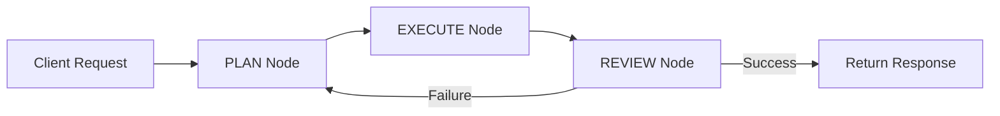

# CSV Agent

A sophisticated AI-powered agent for CSV file manipulation and transformation using natural language instructions.

## 📋 Table of Contents

- [Overview](#overview)
- [Architecture](#architecture)
- [Features](#features)
- [Installation](#installation)
- [Usage](#usage)
- [API Reference](#api-reference)
- [Configuration](#configuration)
- [Development](#development)
- [Diagrams](#diagrams)

---

## 🎯 Overview

CSV Agent is an intelligent service built on a **Plan-Execute-Review** workflow pattern. It accepts natural language instructions and automatically generates execution plans to manipulate CSV files through a combination of:

- **Internal Tools**: Local Python-based transformations
- **MCP Tools**: Remote data processing via Model Context Protocol (Data Factory)
- **LLM Integration**: OpenAI-powered natural language understanding and code generation

### Key Capabilities

- ✅ Convert between CSV, JSON, and structured data formats
- ✅ Transform columns using natural language (rename, add, filter, drop)
- ✅ Transform rows (insert, delete by conditions)
- ✅ Split and merge CSV files
- ✅ Generate CSV data from descriptions
- ✅ File validation and inspection
- ✅ Conversation history tracking for context-aware operations

---

## 🏗️ Architecture

### Layered Architecture Pattern

CSV Agent follows **Clean Architecture** principles with clear separation of concerns:

```
┌─────────────────────────────────────────────────────────────┐
│  Layer 3: Presentation (Agent SDK - FastAPI Routes)        │
├─────────────────────────────────────────────────────────────┤
│  Layer 2: Application (Use Cases, Graph Nodes, Tools)      │
├─────────────────────────────────────────────────────────────┤
│  Layer 1: Domain (Entities, State, Execution Plan)         │
├─────────────────────────────────────────────────────────────┤
│  Layer 4: Frameworks (Config, DI, Adapters, Tool Scanner)  │
└─────────────────────────────────────────────────────────────┘
```

### Workflow Pattern: Plan-Execute-Review



**Flow Description:**

1. **PLAN**: Analyzes request + tool catalog → Generates execution plan via LLM
2. **EXECUTE**: Runs plan steps sequentially → Invokes tools with auto-parameter mapping
3. **REVIEW**: Evaluates results → Decides success or re-plan
4. **Conditional Loop**: If review fails, loop back to PLAN; else complete

### Tool Architecture: Hybrid Model

```
┌──────────────────────┐         ┌──────────────────────┐
│   Internal Tools     │         │     MCP Tools        │
│   (Local Python)     │         │  (Data Factory)      │
├──────────────────────┤         ├──────────────────────┤
│ convert_json_to_csv  │         │ transform_file_mcp   │
│ convert_csv_to_json  │         │ transform_rows_mcp   │
│ create_file          │         │ validate_file_mcp    │
│ get_first_n_rows     │         │ inspect_file_mcp     │
│ get_header           │         │ list_rule_sets_mcp   │
│ import_file_to_node  │         │                      │
│ revert_file          │         │                      │
└──────────────────────┘         └──────────────────────┘
         ↓                                ↓
         └────────────┬───────────────────┘
                      ↓
              Execute Node Logic
      (Auto-detects type by "_mcp" suffix)
```

---

## 🚀 Features

### 1. **Data Conversion**

```python
# JSON to CSV with nested structure flattening
POST /api/v1/execute
{
  "message": "convert to csv",
  "parameters": {
    "json_data": {"users": [{"name": "Alice", "age": 30}]},
    "filename": "output.csv"
  }
}

# CSV to JSON
POST /api/v1/execute
{
  "message": "convert csv to json",
  "parameters": {
    "file_id": "file_019e7e71...",
    "flatten": true
  }
}
```

### 2. **Column Transformations**

Natural language instructions → Polars transformation rules via LLM:

```python
POST /api/v1/execute
{
  "message": "rename column 'Object Type' to '123', add status column with value 'active'",
  "parameters": {
    "file_id": "file_019e7e71..."
  }
}
```

**Supported Operations:**
- Rename columns
- Add/Insert columns with expressions
- Drop columns
- Filter rows by conditions
- Create computed columns

### 3. **Row Transformations**

```python
POST /api/v1/execute
{
  "message": "delete rows where age > 65",
  "parameters": {
    "file_id": "file_019e7e71..."
  }
}

# Insert row
POST /api/v1/execute
{
  "message": "insert row at index 2 with data: name=Bob, age=25",
  "parameters": {
    "file_id": "file_019e7e71..."
  }
}
```

### 4. **File Generation**

```python
POST /api/v1/execute
{
  "message": "create a CSV with employee data: 3 rows with columns name, department, salary",
  "parameters": {}
}
```

LLM generates synthetic data matching your description.

### 5. **File Inspection**

```python
POST /api/v1/execute
{
  "message": "show me the first 10 rows",
  "parameters": {
    "file_id": "file_019e7e71..."
  }
}
```

---

## 📦 Installation

### Prerequisites

- Python 3.9+
- Access to Data Factory MCP server
- OpenAI API key
- File Service endpoint

### Setup

1. **Clone the repository**

```bash
cd apps/backend/agent/csv-agent
```

2. **Install dependencies**

```bash
pip install -r requirements.txt
```

3. **Install MCP client library**

```bash
pip install -e ../../../libs/mcp/python
```

4. **Configure environment**

```bash
cp env.example .env
# Edit .env with your settings
```

5. **Run the agent**

```bash
python main.py
```

Server starts at `http://localhost:37001`

---

## ⚙️ Configuration

### Environment Variables

```bash
# Agent Identity
AGENT_ID=csv-agent-001
AGENT_NAME=CSV Agent
AGENT_TYPE=csv
AGENT_DESCRIPTION=AI-powered CSV manipulation agent

# Service URLs
DATA_FACTORY_URL=https://smdg-ai-dev-data-factory-dev.cfapps.br10.hana.ondemand.com
FILE_URL=https://smdg-ai-dev-file-service-dev.cfapps.br10.hana.ondemand.com
REGISTRY_URL=  # Empty to disable external registry

# OpenAI Configuration
OPENAI_API_KEY=sk-...
OPENAI_MODEL=gpt-4o-mini

# Logging
LOG_LEVEL=INFO

# Server
PORT=37001
HOST=0.0.0.0
```

### Key Settings

**Data Factory URL**: MCP server endpoint for remote transformations  
**File Service URL**: Object storage for upload/download operations  
**Registry URL**: Leave empty ("") to use local tool scanning  

---

## 🛠️ Development

### Project Structure

```
csv-agent/
├── main.py                    # Application entry point
├── bootstrap.py               # Dependency injection & graph composition
├── requirements.txt           # Python dependencies
├── .env                       # Environment configuration
├── app/
│   ├── layer1_domain/        # Domain entities (FileState, ExecutionPlan)
│   ├── layer2_application/   # Application logic
│   │   ├── graphs/           # Workflow nodes & edges
│   │   │   ├── main_flow.py  # Graph definition
│   │   │   ├── nodes/        # Plan, Execute, Review nodes
│   │   │   └── edges/        # Conditional routing logic
│   │   ├── use_cases/        # PlanUseCase, ReviewUseCase
│   │   ├── tools/            # Tool wrappers (scanner discovers these)
│   │   │   ├── csv_tools.py          # Internal tool wrappers
│   │   │   └── mcp_data_factory.py   # MCP tool wrappers
│   │   ├── features/         # Business logic implementations
│   │   │   ├── transform_column.py
│   │   │   ├── transform_row.py
│   │   │   ├── convert_json_to_csv.py
│   │   │   └── ...
│   │   └── interfaces/       # Tool decorator
│   └── layer4_frameworks/    # Infrastructure
│       ├── config/           # Settings, AppConfig
│       ├── dependency/       # IOC container
│       ├── graph/            # Graph builder
│       ├── tools/            # Tool registry & scanner
│       └── adapters/         # External service clients
├── tests/                    # Unit & integration tests
├── deployment/               # Docker & K8s manifests
└── docs/                     # Documentation & diagrams
    ├── sequence-diagram.puml
    ├── class-diagram.puml
    └── README.md             # This file
```

### Adding a New Tool

1. **Create feature implementation** in `app/layer2_application/features/`:

```python
# my_feature.py
async def my_feature_impl(param1: str, param2: int) -> dict:
    # Business logic here
    return {"result": "success"}
```

2. **Create tool wrapper** in `app/layer2_application/tools/csv_tools.py`:

```python
from app.layer2_application.interfaces.register_tool import tool

@tool
async def my_tool(param1: str = None, param2: int = 0) -> dict:
    """
    Tool description for LLM.
    
    Input:
    - param1: description
    - param2: description
    
    Output:
    - result: description
    """
    from app.layer2_application.features.my_feature import my_feature_impl
    return await my_feature_impl(param1, param2)
```

3. **Restart agent** - tool scanner will auto-discover it

### Testing

```bash
# Run all tests
pytest tests/

# Run specific test file
pytest tests/test_transform_column.py

# Run with coverage
pytest --cov=app tests/
```

### Debugging

Enable detailed logging:

```bash
LOG_LEVEL=DEBUG python main.py
```

Watch for these log markers:
- `🔧 TOOL SELECTED:` - Shows which tool was chosen (MCP vs Internal)
- `[Column] Calling MCP` - MCP protocol invocation
- `Auto-serializing` - Parameter type conversion
- `Auto-mapping message to 'long_input'` - Message-to-parameter mapping

---

## 📡 API Reference

### Execute Endpoint

**POST** `/api/v1/execute`

**Request Body:**

```json
{
  "message": "Natural language instruction",
  "parameters": {
    "file_id": "file_019e7e71-...",
    "json_data": {...},
    "filename": "output.csv",
    "long_input": "explicit instruction"
  },
  "conversation_history": [
    {"role": "user", "content": "..."},
    {"role": "assistant", "content": "..."}
  ]
}
```

**Response:**

```json
{
  "status": "success",
  "session_id": "uuid",
  "data": {},
  "agent_data": {
    "file_id": "file_019e7e71-...",
    "summary": {
      "success": true,
      "step_results": [
        {
          "order": 1,
          "tool": "transform_column",
          "success": true,
          "result": {
            "file_id": "file_019e7e71-...",
            "download_url": "https://..."
          },
          "error": null
        }
      ],
      "final_file_id": "file_019e7e71-...",
      "error": null,
      "summary": "Executed 1 steps"
    }
  },
  "duration_ms": 5432.1
}
```

### Health Check

**GET** `/health`

```json
{
  "status": "healthy",
  "agent_id": "csv-agent-001",
  "version": "1.0.0"
}
```

---

## 📊 Diagrams

### Sequence Diagram

See [sequence-diagram.puml](docs/sequence-diagram.puml) for detailed request flow visualization.

**Render with PlantUML:**

```bash
plantuml docs/sequence-diagram.puml
```

**Key Flows:**
1. Request → API → UseCase → Graph
2. PLAN (LLM generates execution plan)
3. EXECUTE (Tool invocation with auto-mapping)
4. REVIEW (Success validation)
5. Response normalization

### Class Diagram

See [class-diagram.puml](docs/class-diagram.puml) for architecture overview.

**Render with PlantUML:**

```bash
plantuml docs/class-diagram.puml
```

**Key Components:**
- Domain entities (FileState, ExecutionPlan, ExecutionResult)
- Application use cases (PlanUseCase, ReviewUseCase)
- Graph nodes (PlanNode, ExecuteNode, ReviewNode)
- Tool wrappers (Internal vs MCP)
- Framework adapters (OpenAI, File Service, MCP Client)

---

## 🔍 Key Implementation Details

### 1. **Auto-Parameter Mapping**

Execute Node automatically handles parameter type mismatches:

```python
# If tool expects string but receives dict:
json_data = {"name": "Alice"}  # dict
# Auto-serialized to:
json_data = '{"name": "Alice"}'  # JSON string
```

### 2. **Message-to-long_input Mapping**

Tools requiring natural language instructions automatically receive the message:

```python
# Request:
{
  "message": "rename column A to B",
  "parameters": {"file_id": "..."}
}

# Execute Node auto-maps:
tool_input = {
  "long_input": "rename column A to B",  # Auto-added
  "file_id": "..."
}
```

### 3. **MCP vs Internal Tool Detection**

```python
if "_mcp" in tool_name:
    # Route to Data Factory via MCP protocol
    tool_type = "🔌 MCP Tool"
else:
    # Execute locally
    tool_type = "⚙️ Internal Tool"
```

### 4. **Error Handling**

- **File Not Found (404)**: Returns clear error with S3 URL
- **Validation Errors**: Pydantic validation with field-level details
- **LLM Failures**: Fallback plans with parameter-based detection
- **MCP Errors**: Protocol-level error extraction from CallToolResult

---

## 🤝 Contributing

### Code Style

- Follow PEP 8
- Use type hints
- Document functions with docstrings
- Keep functions focused (Single Responsibility)

### Commit Guidelines

```
feat: Add new split_csv tool
fix: Handle None values in convert_json_to_csv
docs: Update README with MCP integration details
refactor: Extract LLM prompt to separate file
test: Add integration test for transform_column
```

---

## 📝 License

Copyright (c) 2026 SMDG AI Enhancement Project

---

## 🆘 Support

### Common Issues

**Q: Tool not found in registry**  
A: Ensure tool has `@tool` decorator and is in `app/layer2_application/tools/`

**Q: MCP 406 error**  
A: Check DATA_FACTORY_URL points to `/mcp/http/mcp` endpoint

**Q: File 404 error**  
A: File expired on S3 - upload new file or check presigned URL expiration

**Q: LLM choosing wrong tool**  
A: Check parameters first - LLM prioritizes parameters over message text

### Debug Commands

```bash
# Check tool registry
curl http://localhost:37001/api/v1/tools

# Health check
curl http://localhost:37001/health

# MCP server info
curl https://smdg-ai-dev-data-factory-dev.cfapps.br10.hana.ondemand.com/mcp/info
```

---

## 🎯 Roadmap

- [ ] Add Excel transformation support
- [ ] Implement streaming for large files (>10MB)
- [ ] Add batch processing API
- [ ] Support custom Polars expressions via UI
- [ ] Add data validation rule builder
- [ ] Implement file version history
- [ ] Add webhook notifications for long-running operations

---

**Built with ❤️ by SMDG AI Team**
