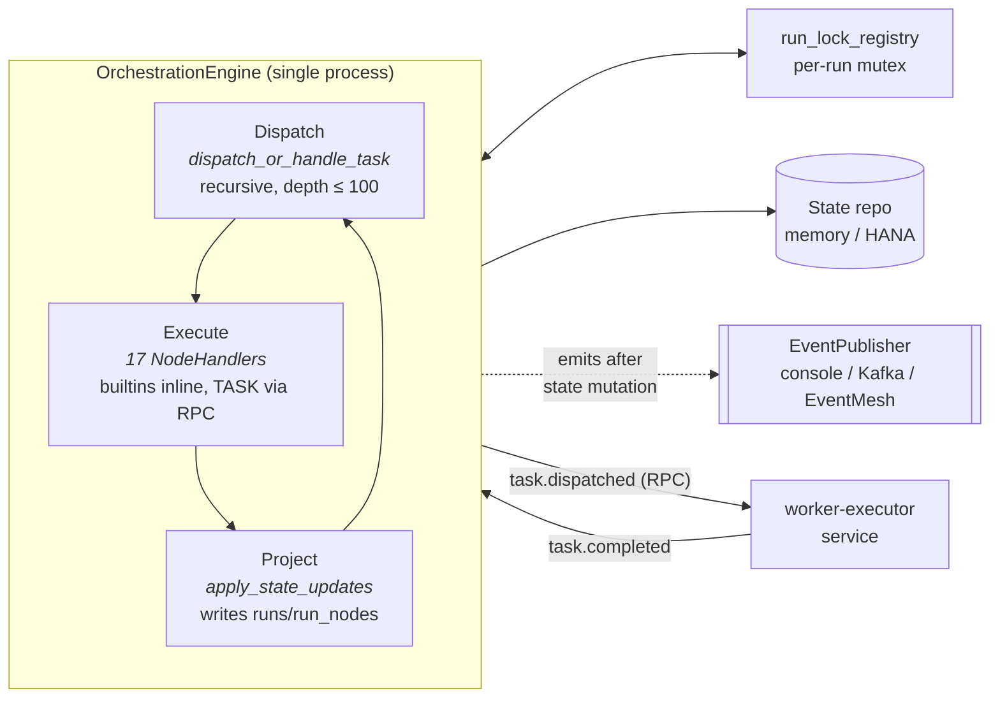
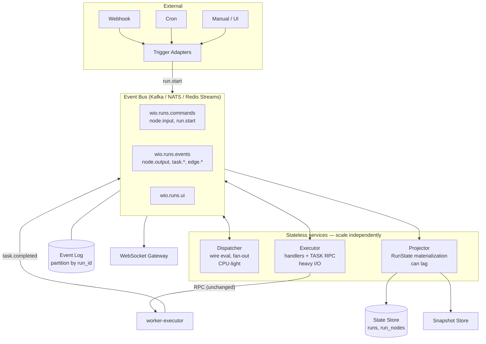
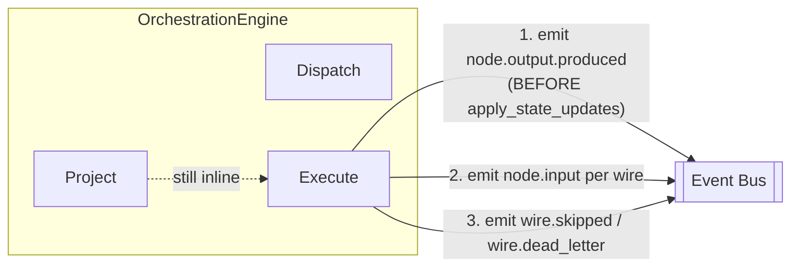
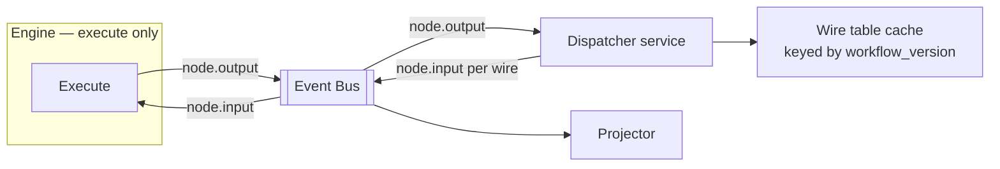
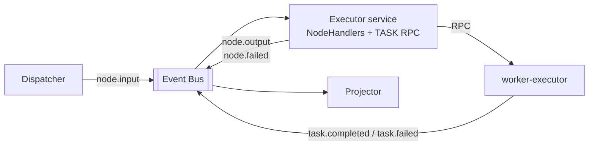
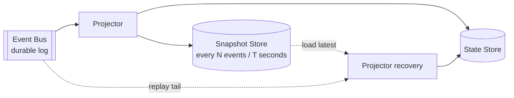

# Engine Split — Dispatcher + Executor + Projector over a Real Bus

> Plan and impact analysis for the top-ranked gap in
> [`event-driven-orchestration.md`](./event-driven-orchestration.md) §26.3:
> splitting today's monolithic `OrchestrationEngine` into three stateless
> services (Dispatcher, Executor, Projector) communicating via a real event bus.
>
> Until this split happens, two design promises remain aspirational:
> **horizontal scaling** and **replay-from-checkpoint**.
>
> Scope: the Python/FastAPI `workflow-control-plane-service` only. Worker
> executor and workers are mentioned where they interact but are not the subject.

---

## 1. Why This Doc Exists

The current `OrchestrationEngine` (`workflow-control-plane-service/app/layer1_domain/services/orchestration_engine.py`) bundles three distinct concerns into one process:

1. **Dispatch** — walk the DAG, decide which successors are ready, fan out.
2. **Execute** — run node handlers (builtins inline, TASK via RPC to worker-executor).
3. **Project** — mutate `runs` / `run_nodes` state as execution progresses.

Event emission happens *alongside* state mutation, not as its source. As a
consequence:

- **Scale is one-dimensional.** More engines = more `run_lock_registry`
  contention; no way to scale dispatch independently from execution.
- **Replay is impossible.** Events are a by-product, not authoritative; you
  cannot reconstruct `RunState` from the event stream alone.
- **Failure domains are coupled.** A slow handler or a Projector-style DB write
  blocks the whole run.

This document describes how to unpick those concerns incrementally and what
breaks (or doesn't) along the way.

---

## 2. Current State — One Process, Three Jobs

Key tells that confirm the merge:

- `dispatch_or_handle_task()` calls the next handler recursively **in Python**,
  not via a `node.input` event hop.
- `apply_state_updates()` fires **before** `node.output.produced` is emitted —
  the event trails the state change, which is the opposite of source-of-truth.
- `run_lock_registry.py` exists only because one engine process handles a whole
  run; a partitioned bus would make this unnecessary.
- `wire.skipped` and `wire.dead_letter` topics are referenced in the design but
  not emitted today; skipping is handled inline by
  `collect_downstream_nodes_to_skip()`.

---

## 3. Target State — Three Services on a Bus

Per-run ordering is preserved by partitioning the bus on `run_id`. Across runs,
everything is parallel. The `run_lock_registry` is deleted.

---

## 4. Migration Phases

Five phases, each independently deployable, each with a clear exit criterion.

| Phase | Goal | Blocks merge of |
|---|---|---|
| 0 | Events become source of truth (no split yet) | 1, 2 |
| 1 | Extract Projector (shadow → authoritative) | 4 |
| 2 | Extract Dispatcher | 3 |
| 3 | Extract Executor; delete `run_lock_registry` | 4 |
| 4 | Snapshot store + real replay-from-checkpoint | — |

### Phase 0 — Make events authoritative (prep)

**Changes**

- Add missing topics: `node.input`, `wire.skipped`, `wire.dead_letter`.
- Re-order emission: `node.output.produced` fires **before** state mutation.
- Audit every `publish(...)` call site to use `deterministic_event_id(...)` —
  replay needs stable ids. The helper already exists; enforce it.
- CONDITION/SWITCH `EdgeTraversed` emission: make an explicit decision now —
  keep in handler or move to Dispatcher. Today's
  `_HANDLER_EMITS_EDGE_EVENTS` hack must not survive the Dispatcher extraction.

**Exit criterion:** a run's event stream is self-sufficient — given
`run.started` + all downstream events, an external consumer can reconstruct the
full DAG execution path without reading engine internal state.

**Risk:** low. No topology change; all writes still go through the engine.

---

### Phase 1 — Extract the Projector (shadow, then authoritative)

```mermaid
flowchart LR
    ENG[OrchestrationEngine<br/>still writes state inline]
    BUS[[Event Bus]]
    PRJ[Projector service<br/>apply&#40;state, event&#41;]
    STATE_A[(State Store — written<br/>by engine)]
    STATE_B[(State Store — shadow<br/>written by projector)]

    ENG --> BUS
    ENG --> STATE_A
    BUS --> PRJ
    PRJ --> STATE_B

    CMP["Parity compare<br/>engine vs. projector"]
    STATE_A --> CMP
    STATE_B --> CMP
```

**Why first:** the Projector is read-only from the engine's perspective. If it
disagrees with inline writes, you fix `apply()` and replay — no handler
correctness risk.

**Steps**

1. Stand up Projector service subscribed to `wio.runs.events`.
2. Implement `apply(state, event) -> state` — pure fold.
3. Feature flag `PROJECTOR_MODE={shadow,authoritative}`:
   - `shadow`: both engine and projector write; parity comparator logs drift.
   - `authoritative`: engine stops writing state; projector is source of truth.
4. Run `shadow` for N days in production. Define acceptance: zero parity
   failures over X runs of representative workflows.
5. Flip to `authoritative`. Remove inline state writes from engine.

**Exit criterion:** deleting `apply_state_updates` from the engine leaves the
system functionally unchanged.

**Unblocks:** snapshots, replay, cheap Projector bugfixes.

---

### Phase 2 — Extract the Dispatcher

**Steps**

1. Lift `compute_fanout` (`services/dispatcher/fanout.py` — already partially
   extracted) and wire-skip logic into a standalone Dispatcher service.
2. Add workflow-version-keyed wire-table cache. Invalidate on workflow update.
3. Dispatcher consumes `node.output`, emits `node.input` for each matching wire,
   emits `wire.skipped` / `wire.dead_letter` where appropriate.
4. Engine's `dispatch_or_handle_task` recursion is replaced by: emit
   `node.output` → bus → Dispatcher → `node.input` → engine handles.
5. Delete `run_lock_registry` once bus partitioning by `run_id` is verified.
6. Resolve CONDITION/SWITCH edge-emission caveat permanently: Dispatcher owns
   all `edge.traversed`, handlers emit only `condition.evaluated` /
   `switch.evaluated`.

**Exit criterion:** the engine has no direct reference to the DAG adjacency
structure. It only reacts to `node.input` events.

**Risk:** medium. Loop handling (`event_driven_loop_driver`) and PARALLEL/MERGE
semantics interact with fan-out. Test matrix must cover queued-mode loops,
parallel fan-out with partial skip, and cross-workflow calls.

---

### Phase 3 — Extract the Executor

**Steps**

1. Package handlers as a standalone Executor deployment.
2. Decide split: keep BUILTIN handlers (cheap) colocated with Dispatcher? or
   one Executor pool for everything? Start unified; split later if one
   handler family dominates CPU.
3. **Idempotency bar**: every handler must tolerate at-least-once redelivery.
   Two routes:
   - Pure-output handlers (CONDITION, SWITCH, COMPUTE, TRIGGER, PARALLEL,
     MERGE, LOOP*) — deduplicate on `(run_id, node_id, attempt)`.
   - Side-effect handlers (DATA_EDIT, HITL resume) — **outbox pattern**
     (§25.3 in the design doc) before they can run on an Executor.
4. Kill-a-replica test: mid-handler crash should result in redelivery and
   successful completion, no duplicate side effects.

**Exit criterion:** N Executor replicas can be started/stopped freely; one run's
throughput scales with replica count up to its critical-path bound.

**Risk:** high. Most handler-level bugs surface here. Budget heavily for
observability and chaos tests.

---

### Phase 4 — Snapshot Store and Real Replay

**Steps**

1. Projector emits periodic snapshots of `RunState` keyed by `(run_id, seq)`.
2. On cold start: load snapshot → replay events with `seq > snapshot.seq`.
3. Forensic mode: spin up a throwaway Projector against a past run's log
   window to debug production issues.

**Exit criterion:** killing the Projector mid-run and restarting yields correct
final state in O(bounded-tail) events, not O(total events).

---

## 5. Bus Topics — Added, Reshaped, Deprecated

See `workflow-control-plane-service/app/layer1_domain/events.py` for current
`EventTopic` enum. The table below is relative to that file.

| Topic | Status | Phase | Notes |
|---|---|---|---|
| `run.started`, `run.completed`, `run.failed`, `run.cancelled`, `run.paused`, `run.resumed` | unchanged | — | Projector consumer added |
| `run.start` (command) | **new** | 2 | Replaces imperative `StartRunUseCase` dispatch; Dispatcher consumes |
| `task.dispatched` | reshaped | 2 | Now emitted **by Executor** after input resolution, not by engine |
| `task.completed`, `task.failed`, `task.retrying`, `task.skipped`, `task.resumed`, `task.rerun` | unchanged | — | Producers unchanged; consumers expanded (Projector) |
| `node.input` | **new** | 0 (emit), 2 (consume) | Emitted when Dispatcher resolves a wire; consumed by Executor |
| `node.output.produced` | ordering change | 0 | Must be emitted **before** state mutation |
| `wire.skipped` | **new** | 0 | Emitted by Dispatcher for wires whose filter dropped the payload |
| `wire.dead_letter` | **new** | 0 | Emitted when no wire matches and node has no `on_exec_error` policy |
| `edge.traversed` | ownership change | 2 | Sole producer becomes Dispatcher; handlers no longer emit |
| `condition.evaluated`, `switch.evaluated` | unchanged | — | Stay with their handlers (pure observation) |
| `input.requested`, `human_action.requested`, `data_edit.requested` | unchanged | — | HITL producers stay in handlers; consumers unchanged |
| `input.submitted`, `human_action.completed`, `data_edit.completed` | unchanged | — | Still emitted by `ResumeRunUseCase` |
| `context.updated`, `node.output.produced` | consumer change | 1 | Projector now primary consumer |
| `child_run.started`, `child_run.completed` | unchanged | — | WORKFLOW handler producer unchanged |
| `LoopIterationStarted`, `LoopIterationCompleted`, `LoopCompleted` | unchanged | — | `event_driven_loop_driver` already event-shaped |

**Partitioning key for all `wio.runs.*` topics:** `run_id`. Non-negotiable.

**Retention:** Event Log minimum = longest replay window + snapshot interval
× 2. Start with 7 days; tune on Phase 4 metrics.

---

## 6. Handler Migration Table

All 17 handlers in
`workflow-control-plane-service/app/layer1_domain/services/node_handlers/`.
Column meanings:

- **Category**: BUILTIN (inline today), PENDING (HITL), TASK (worker RPC).
- **Phase 3 home**: where it lives after Executor extraction.
- **Idempotency**: route — dedupe on replay key, or outbox pattern required.
- **Migration risk**: low / med / high. Drives test budget.

| Handler | Category | Phase 3 home | Idempotency | Risk | Notes |
|---|---|---|---|---|---|
| `condition_handler.py` | BUILTIN | Executor | Dedupe `(run_id, node_id, attempt)` | low | Pure function of input; move `EdgeTraversed` emission to Dispatcher in Phase 2 |
| `switch_handler.py` | BUILTIN | Executor | Dedupe | low | Same caveat as CONDITION |
| `compute_handler.py` | BUILTIN | Executor | Dedupe | low | COMPUTE is a pure expression evaluator |
| `merge_handler.py` | BUILTIN | Executor | Dedupe | med | Join semantics across partial-skip paths need explicit tests |
| `parallel_handler.py` | BUILTIN | Executor | Dedupe | med | Fan-out timing moves onto the bus; verify ordering guarantees |
| `loop_handler.py` | BUILTIN | Executor | Dedupe | high | Already partly event-driven via `event_driven_loop_driver`; queued-mode tests cover inline, need coverage for bus-mode |
| `loop_continue_handler.py` | BUILTIN | Executor | Dedupe | high | Iteration state lives in `RunContext` today; must survive being rehydrated from Projector in Phase 3 |
| `loop_exit_handler.py` | BUILTIN | Executor | Dedupe | high | Same |
| `trigger_handler.py` | BUILTIN | Executor | Dedupe | low | Virtual `$trigger` node — effectively a no-op handler |
| `workflow_handler.py` | BUILTIN | Executor | Dedupe + idempotent child `run.start` | med | Sub-workflow call; child `run_id` must be deterministic for replay |
| `task_handler.py` | TASK | Executor | Idempotency key already flows to worker-executor | low | Existing RPC boundary; redelivery hits worker-executor's own idempotency path |
| `input_handler.py` | PENDING | Executor | Idempotent `InputRequested` emit; resume path is a new event | med | Emission is pure; resume-side state update crosses into outbox territory |
| `human_action_handler.py` | PENDING | Executor | Same as INPUT | med | Same |
| `data_edit_handler.py` | PENDING | Executor | **Outbox required** | high | Writes file refs through `ResumeRunUseCase`; duplicate side effects possible without outbox |
| `file_upload_handler.py` | PENDING | Executor | Dedupe on `file_id` | med | Depends on file-service idempotency |

**Net result by Phase 3:** all 17 handlers live in the Executor service.
BUILTIN vs. PENDING vs. TASK becomes an internal classification for handler
dispatch within Executor, not a service boundary.

---

## 7. Cross-Cutting Work

Required regardless of phase:

- **Bus choice.** Design says pluggable; pick a default. Candidates and trade-offs:
  - **Kafka** — strongest partition-ordering story, heaviest ops burden.
  - **NATS JetStream** — lighter ops, good per-subject ordering.
  - **Redis Streams** — lightest ops, weakest durability guarantees.
  - Mock/console and in-memory asyncio drivers stay for dev and tests.
- **Observability.** OpenTelemetry trace context propagated through every
  event envelope. Without this, debugging degrades — you traded one stack
  trace for N bus hops. Budget is **not** optional.
- **Idempotency audit.** Every handler tagged in §6 with "Dedupe" needs a
  documented dedupe key. Every "Outbox required" handler needs the outbox
  wired before Phase 3 starts.
- **Deterministic ids.** `deterministic_event_id()` must be used at every
  emission site; add a lint or test that fails when a raw `uuid4()` appears
  in an event payload.
- **Test matrix.** Kill-a-replica, duplicate-delivery, out-of-order within
  partition (should not occur but test the guard), bus-down degradation.

---

## 8. Impact Analysis

### 8.1 What improves

| Capability | Before | After |
|---|---|---|
| Horizontal scale | One engine process per run at a time (lock registry) | Dispatcher / Executor / Projector scale independently; bus partition = parallelism unit |
| Replay-from-checkpoint | Impossible (state writes are not event-driven) | Snapshot + tail replay; forensic projectors on demand |
| Failure isolation | Slow handler stalls whole run; Projector-style DB write stalls execution | Executor isolated from Dispatcher; Projector can lag |
| Projector bugfix cost | Ship engine release, hope state converges | Ship Projector, replay log |
| `run_lock_registry` | Required | Deleted |
| Other §26.3 items (error ports, outbox, max_loop_depth) | Each needs engine surgery | Land cleanly in services with one job |

### 8.2 What it costs

| Cost | Detail |
|---|---|
| Operational complexity | 1 process → 3 services + durable bus. On-call runbook grows; deployment and alerting get harder. |
| Short-run latency | Trivial 3-node workflow: 50ms inline Python → 3–5 bus hops. Likely **+10–100ms p50**. Long runs amortize; canvas "try this node" UX notices. |
| Event-shape breaking changes | New topics (`node.input`, `wire.skipped`, `wire.dead_letter`), reordered `node.output.produced`, ownership change for `edge.traversed`. Per `feedback_clean_redesign_no_legacy`: drop compat shims; do not dual-read. Consumers (Socket.IO realtime, analytics) must adapt in lockstep. |
| Idempotency bar | Today's handlers assume single-delivery. Every handler must become replay-safe or outbox-backed. This is its own project embedded in Phase 3. |
| Debugging shape | Stack traces stop telling the whole story. OTel tracing across events is a hard prerequisite, not an afterthought. |
| Schedule | Realistically 2–3 months of focused engineering through Phase 3. Phase 4 (snapshots done right) adds another month. |

### 8.3 When not to do this

If current load fits in one engine process and replay is not a product or
compliance requirement, this is infrastructure tax with no user-visible
payoff. §26.3 ranks it highest by *distance from design intent*, not by
*user-facing pain*. Be honest about which metric drives the decision.

Trigger conditions that justify starting:

- Run concurrency routinely contends on `run_lock_registry` in production.
- A replay / audit requirement lands from compliance or product (time-travel
  debugging, run forking).
- A single handler family (typically LOOP-bodies or COMPUTE) is pinning the
  whole engine on CPU.

Absent one of those, Phase 0 is still cheap and worth shipping — it makes the
event log authoritative and unblocks the rest without committing to the split.

---

## 9. Rollback Strategy

Per phase:

| Phase | Rollback | Data loss risk |
|---|---|---|
| 0 | Revert emission-order and topic-add PRs. | None; additive. |
| 1 shadow | Ignore Projector's shadow state; nothing to undo. | None. |
| 1 authoritative | Re-enable inline state writes; rehydrate from last known-good snapshot of Projector's state store. | Low; `run_nodes` is idempotent on `(run_id, node_id)`. |
| 2 | Re-collapse Dispatcher into engine; re-introduce `run_lock_registry`. Emitted `node.input` events are drained from bus. | Medium; in-flight runs may need manual kick. |
| 3 | Re-collapse Executor into engine. **Handlers keep their idempotency and outbox work** — those are improvements regardless. | Medium; same as Phase 2. |
| 4 | Stop emitting snapshots; Projector falls back to full replay. | None; snapshots are a performance optimization. |

A failed Phase 3 rollback is the worst case. Run Phase 3 in a non-production
environment at full replica count for a month before touching production.

---

## 10. Open Questions

1. Bus choice (Kafka / NATS / Redis Streams). Needs an ADR of its own.
2. Do BUILTIN handlers stay with the Executor or colocate with Dispatcher?
   Default: Executor. Revisit if CPU profile says otherwise.
3. Outbox implementation: shared library across handlers vs. per-handler. Leans
   shared — fewer ways to get it wrong.
4. How does `WorkflowRun.is_test` interact with the event log? Test-mode runs
   currently skip persistence side effects; likely they emit to a separate
   topic or carry a `test=true` header that Projector filters.
5. Whether to persist the SQL `run_events` table at all once the bus log is
   durable. Design §5.2 says it's optional for cold storage / compliance.

---

## Appendix — Related Documents

| Doc | Relevance |
|---|---|
| [event-driven-orchestration.md](./event-driven-orchestration.md) | Target architecture (§4); this doc operationalizes §26.3 item 1 |
| [event-driven-gap-analysis.md](./event-driven-gap-analysis.md) | Current-state snapshot (40% there, gaps concentrated in one file) |
| [event-driven-execution-plan.md](./event-driven-execution-plan.md) | Broader migration plan covering non-split work |
| [loop-event-driven-spike.md](./loop-event-driven-spike.md) | Loop-handler event-driven transition — input for §6 risk tiers |
| [phase-6-uniform-execution-completion.md](./phase-6-uniform-execution-completion.md) | Uniform dispatch→execute→complete→route pattern across node types |
