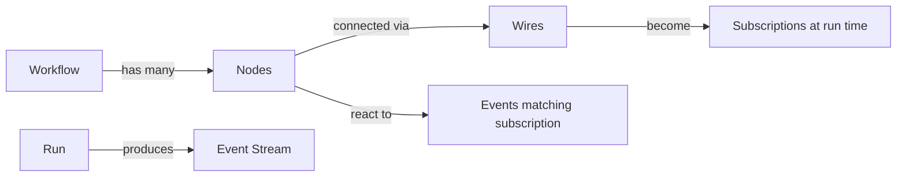
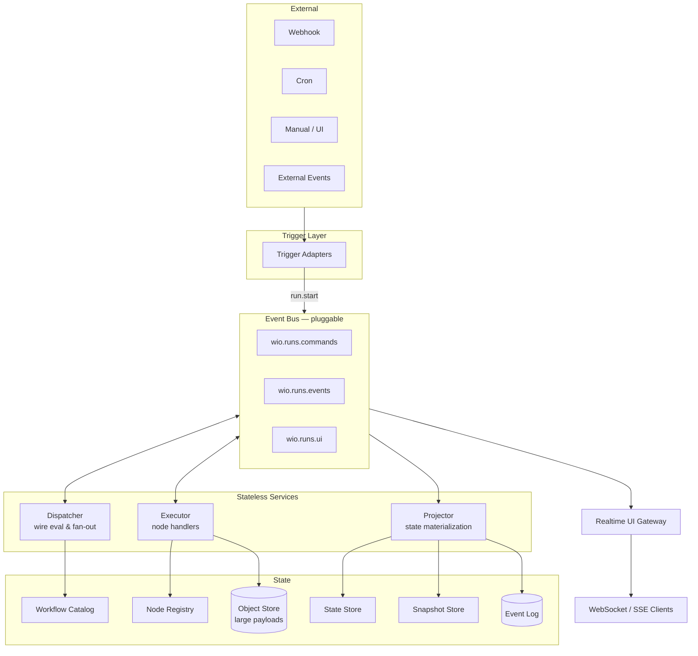
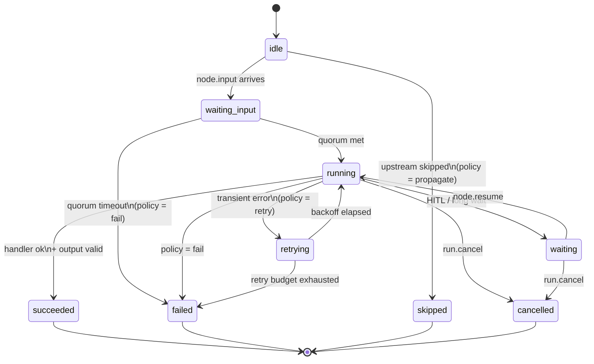
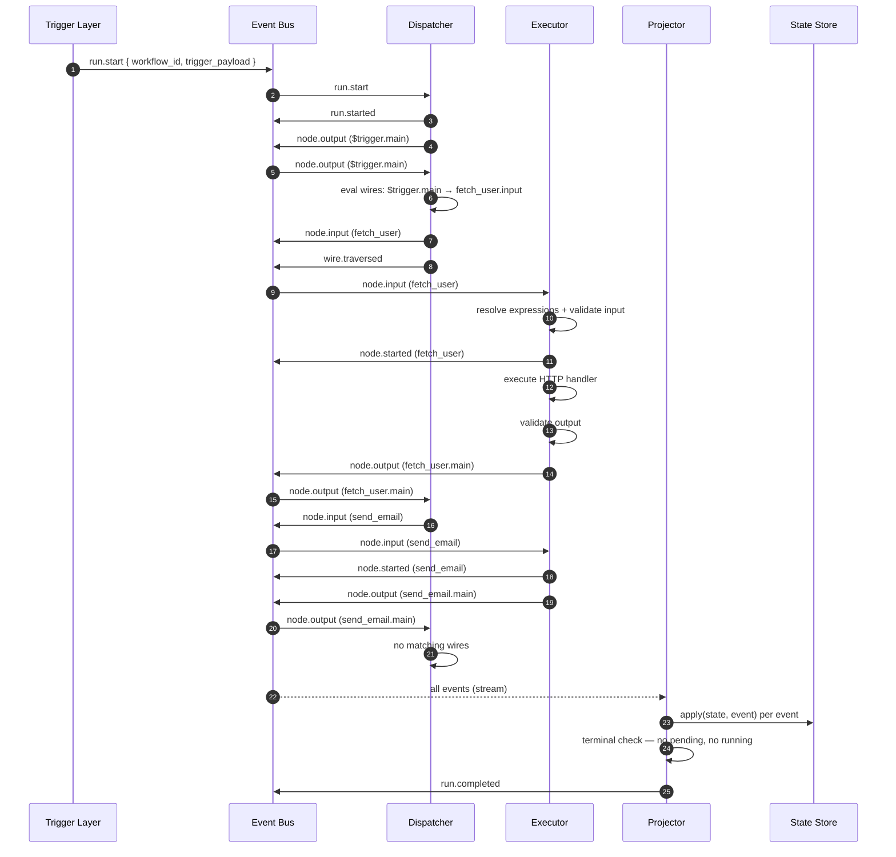
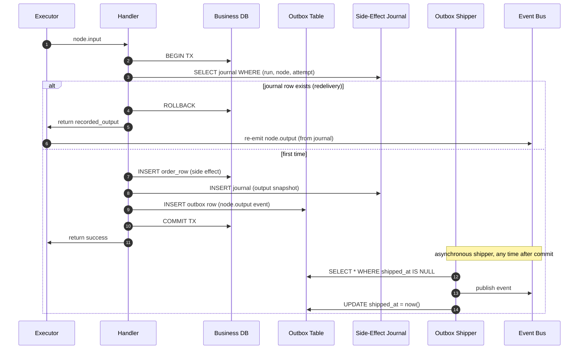

# Event-Driven Orchestration System — Design Document

> A greenfield design for a workflow orchestration engine inspired by n8n, built around an event bus with **runtime validation only** (no pre-run DAG analysis). Language-agnostic, pluggable event backbone, full-depth scope, per-node-configurable validation.

---

## 1. Context & Motivation

Existing orchestration engines typically parse a workflow definition into a DAG, validate the whole graph before execution (schema compatibility, cycle detection, type checks), then walk the graph. This has costs:

- **Rigidity.** Any edit to the definition triggers a full re-validation and can reject partially-working workflows.
- **Poor fit for dynamic topologies.** Sub-workflows, user-supplied branches, and runtime-generated nodes are hard to validate statically.
- **Tight coupling.** The engine must know the full graph shape up front, which makes horizontal scaling and fault recovery harder.
- **Validation mismatch.** Static schemas often disagree with what data actually arrives at runtime (APIs return unexpected shapes, user inputs drift), so you still need runtime checks — doubling the work.

**Goal:** an n8n-style workflow engine where **nodes react to events**, validation happens **when an event actually arrives at a node**, and the "graph" is really just a set of subscriptions that can be changed at any time without re-validating anything.

---

## 2. Design Goals

| Goal | Meaning |
|---|---|
| **Event-first** | Every execution step is the consumption of one event and the emission of zero or more new events. No central scheduler walks a graph. |
| **Runtime validation only** | Workflows are accepted as-is. Validation fires when a node receives an event, not before. |
| **Per-node failure policy** | Each node declares how to react to a validation or execution failure (fail-fast, continue, retry, default value, route to error output). |
| **Pluggable bus** | In-process asyncio bus for dev/single-node, Kafka/NATS/Redis Streams for distributed deployments. Same engine code, different driver. |
| **Replayable** | The event log is the source of truth. A run can be reconstructed, forked, or replayed from any point. |
| **Horizontally scalable** | Stateless executors. State lives in the event log + snapshot store. |
| **Dynamic topology** | Workflow definitions can be edited mid-run; new subscriptions take effect on the next emitted event. |
| **Visible like n8n** | First-class UI events so a canvas can light up node-by-node as events flow. |

### Non-goals

- Strong static type guarantees before run.
- Cycle rejection at design time (cycles are allowed; runtime guards handle them).
- A specific language/runtime. This document specifies the architecture; concrete implementations can pick their own.

---

## 3. Core Concepts



### 3.1 Node

A unit of work. Minimal descriptor:

```yaml
id: http_fetch_user         # unique within the workflow
type: http.request          # registry key → handler implementation
version: 1
config:                     # static parameters (URL template, method, headers…)
  url: "https://api.example.com/users/{{ $trigger.user_id }}"
  method: GET
input_schema: "ref:http.request.input.v1"     # used at runtime, not before
output_schema: "ref:http.request.output.v1"
policy:                     # per-node failure behavior (see §11)
  on_validation_error: fail
  on_exec_error: retry
  retry: { max: 3, backoff: exponential, base_ms: 200 }
  timeout_ms: 30000
outputs: [main, error]      # named output ports
```

Key property: a node knows **nothing** about its position in a graph. It only knows which events it subscribes to (via the wire table) and what events it emits.

### 3.2 Wire

A directional subscription:

```yaml
from: http_fetch_user.main
to:   transform_user.input
filter: "$.status == 200"   # optional predicate, evaluated at runtime
map:    "$.body"            # optional projection on the payload
```

Wires are just rows in a table — adding, removing, or editing them is cheap and requires no graph validation.

### 3.3 Event

The unit of work that flows through the system. Every event has:

```json
{
  "event_id":    "uuid",
  "run_id":      "uuid",
  "workflow_id": "uuid",
  "workflow_version": 7,
  "type":        "node.output",
  "source":      { "node_id": "http_fetch_user", "port": "main" },
  "payload":     { "...": "..." },
  "correlation": { "trace_id": "...", "parent_event_id": "..." },
  "causal_path": ["$trigger", "http_fetch_user"],
  "loop_depth":  0,
  "occurred_at": "2026-04-10T11:22:33.456Z",
  "schema_ref":  "http.request.output.v1",
  "attempt":     1
}
```

### 3.4 Run

An instance of a workflow execution. Identified by `run_id`. Holds:

- The pinned `workflow_version` (wires are snapshotted on start so mid-edit runs stay stable, unless the workflow is flagged "live edit").
- A monotonically-growing event log.
- A node-state map derived from the log.
- Metadata (started_at, trigger info, user context).

---

## 4. High-Level Architecture



### 4.1 Components

| Component | Responsibility | Stateless? |
|---|---|---|
| **Trigger Layer** | Accepts webhooks, schedules, manual starts, external events. Emits `run.start`. | Yes |
| **Event Bus** | Pub/sub transport. Pluggable driver: `InMemoryBus`, `KafkaBus`, `NatsBus`, `RedisStreamsBus`. Provides at-least-once delivery, per-run ordering, and a durable log. | — |
| **Dispatcher** | Subscribes to `node.output` events. Reads the wire table for the workflow version, evaluates wire filters/maps, emits `node.input` events for each matching target. Stateless. | Yes |
| **Executor** | Subscribes to `node.input` events. Looks up the node handler, validates input, runs it, validates output, emits `node.output` (or `node.failed`). Shards by `run_id` for ordering. | Yes |
| **Projector** | Subscribes to the full event stream and maintains the `RunState` materialized view (node statuses, outputs, counters). | Effectively |
| **State Store** | Key-value store holding the materialized run state. | — |
| **Event Log** | Append-only, ordered per `run_id`. Source of truth. Often the same system as the event bus (Kafka log, NATS JetStream, Redis Streams). | — |
| **Snapshot Store** | Periodic RunState snapshots for fast recovery and replay-from-checkpoint. | — |
| **Realtime/UI Gateway** | Consumes `wio.runs.ui` topic and fans out to WebSocket rooms keyed by `run_id`, `workflow_id`. | Yes |
| **Node Registry** | Maps `node.type + version` to a handler implementation. Discovered at startup. | — |
| **Workflow Catalog** | Stores workflow definitions (nodes, wires, metadata) with versioning. | — |

### 4.2 Why three services (Dispatcher / Executor / Projector)

They represent three different concerns that can scale independently:

- **Dispatcher** is CPU-light, read-heavy on the wire table → aggressive caching, high fan-out.
- **Executor** is the heavy worker — it runs user code and I/O. Isolated failure domain.
- **Projector** is purely read/write on state; it can lag without blocking execution.

All three are stateless and can run as many replicas as needed. Sharding is by `run_id` (hash-partitioned) so events within a run are processed in order.

---

## 5. Data Model

### 5.1 Workflow Definition

```sql
workflows (
  id              UUID PK,
  name            TEXT,
  latest_version  INT
)

workflow_versions (
  workflow_id     UUID FK,
  version         INT,
  created_at      TIMESTAMPTZ,
  definition      JSONB,          -- { nodes: [...], wires: [...], settings: {...} }
  PRIMARY KEY (workflow_id, version)
)
```

Note: the definition is stored as a blob. **No pre-parsing, no pre-validation.** The catalog will happily store a workflow with dangling wires, cycles, or missing nodes.

### 5.2 Run State

```sql
runs (
  id                UUID PK,
  workflow_id       UUID,
  workflow_version  INT,
  status            TEXT,          -- queued, running, succeeded, failed, cancelled, paused
  trigger           JSONB,
  started_at        TIMESTAMPTZ,
  finished_at       TIMESTAMPTZ,
  last_event_seq    BIGINT
)

run_nodes (
  run_id            UUID FK,
  node_id           TEXT,
  status            TEXT,          -- idle, waiting_input, running, succeeded, failed, skipped, retrying
  attempt           INT,
  last_event_id     UUID,
  input             JSONB,
  output            JSONB,
  error             JSONB,
  updated_at        TIMESTAMPTZ,
  PRIMARY KEY (run_id, node_id)
)

run_events (
  run_id            UUID,
  seq               BIGINT,        -- per-run monotonically increasing
  event_id          UUID,
  type              TEXT,
  source_node       TEXT,
  source_port       TEXT,
  target_node       TEXT,
  payload           JSONB,
  occurred_at       TIMESTAMPTZ,
  PRIMARY KEY (run_id, seq)
)
```

`run_events` can be backed directly by the message log if the chosen backbone supports it (Kafka compacted topic partitioned by `run_id`, NATS JetStream stream, etc.). In that case the SQL table is optional and exists only for cold storage / compliance.

---

## 6. Event Catalog

Events are the public contract of the engine. Adding a new event type should be rare.

Topic names are dot-notation strings, defined canonically in `workflow-control-plane-service/app/layer1_domain/events.py` (`EventTopic` enum) with one `DomainEvent` dataclass per topic.

### 6.1 Run lifecycle

| Topic | Dataclass | Producer | Consumer | Key payload |
|---|---|---|---|---|
| `run.started`   | `RunStarted`   | OrchestrationEngine | Projector, UI | `run_id`, `workflow_id` |
| `run.completed` | `RunCompleted` | OrchestrationEngine | Projector, UI, parent (callback) | `run_id`, `status`, `output_data`, `correlation_id`, `callback_topic` |
| `run.failed`    | `RunFailed`    | OrchestrationEngine | Projector, UI | `run_id`, `error`, `failed_task_id` |
| `run.cancelled` | `RunCancelled` | OrchestrationEngine | Projector, UI | `run_id`, `cancelled_by`, `reason` |
| `run.paused`    | `RunPaused`    | OrchestrationEngine | Projector, UI | `run_id`, `workflow_id` |
| `run.resumed`   | `RunResumed`   | OrchestrationEngine | Projector, UI | `run_id`, `workflow_id` |

> **Note on `run.start` (the design's input command):** the current codebase has no distinct `run.start` command topic — starting a run is an imperative `StartRunUseCase` call that emits `run.started` directly. The design's command/event split is aspirational.

### 6.2 Task lifecycle (equivalent to the design's `node.*`)

In the code, unit-of-work events are named `task.*` rather than `node.*`. A "task" is the dispatchable representation of a node execution (id = `task_id`, carries `node_id`).

| Topic | Dataclass | Producer | Consumer | Key payload |
|---|---|---|---|---|
| `task.dispatched` | `TaskDispatched` | OrchestrationEngine | worker-executor, Projector, UI | `task_id`, `node_id`, `worker_type`, `input`, `node_config`, `idempotency_key`, `iteration_index` |
| `task.completed`  | `TaskCompleted`  | worker-executor / inline handler | OrchestrationEngine, Projector, UI | `task_id`, `node_id`, `status`, `execution_time_ms` |
| `task.failed`     | `TaskFailed`     | worker-executor / inline handler | OrchestrationEngine, Projector, UI | `task_id`, `node_id`, `error_code`, `error_message`, `attempt` |
| `task.retrying`   | `TaskRetrying`   | worker-executor | Projector, UI | `task_id`, `attempt`, `next_retry_at` |
| `task.skipped`    | `TaskSkipped`    | OrchestrationEngine | Projector, UI | `task_id`, `node_id`, `reason` (`"branch_not_taken"` default) |
| `task.resumed`    | `TaskResumed`    | OrchestrationEngine | Projector, UI | `task_id`, `node_id` |
| `task.rerun`      | `TaskRerun`      | OrchestrationEngine | Projector, UI | `task_id`, `node_id`, `previous_status` |

> **Mapping to §9's flow:** the design's `node.input` is not emitted as a distinct topic today — input resolution happens synchronously inside `dispatch_or_handle_task` before `task.dispatched`. `node.started` is likewise absent; `task.dispatched` plus the worker's internal state covers it. `node.waiting` is not an event topic — waiting state is inferred from `input.requested` / `human_action.requested` / `data_edit.requested`.

### 6.3 Pending-node (HITL) interactions

| Topic | Dataclass | Producer | Consumer | Key payload |
|---|---|---|---|---|
| `input.requested`         | `InputRequested`         | OrchestrationEngine (INPUT handler)       | UI | `task_id`, `node_id`, `input_schema`, `instruction` |
| `input.submitted`         | `InputSubmitted`         | `ResumeRunUseCase` (user POST)            | OrchestrationEngine | `task_id`, `node_id` |
| `human_action.requested`  | `HumanActionRequested`   | OrchestrationEngine (HUMAN_ACTION)        | UI | `task_id`, `instruction`, `confirm_label`, `reject_label` |
| `human_action.completed`  | `HumanActionCompleted`   | `ResumeRunUseCase`                        | OrchestrationEngine | `task_id`, `action` (confirm/reject) |
| `data_edit.requested`     | `DataEditRequested` (extends `InputRequested`) | OrchestrationEngine (DATA_EDIT) | UI | adds `source_file_id`, `source_node_id`, `source_node_name` |
| `data_edit.completed`     | `DataEditCompleted`      | `ResumeRunUseCase`                        | OrchestrationEngine | `task_id`, `file_id`, `source_node_id` |

### 6.4 DAG routing & node output

| Topic | Dataclass | Producer | Consumer | Key payload |
|---|---|---|---|---|
| `edge.traversed`       | `EdgeTraversed`       | OrchestrationEngine (and CONDITION/SWITCH handlers — see the §7.3 caveat) | Projector, UI | `edge_id`, `source_node_id`, `target_node_id`, `source_port_id`, `iteration_index` |
| `node.output.produced` | `NodeOutputProduced`  | OrchestrationEngine (after `apply_state_updates`) | Projector | `node_id`, `state_updates` (every variable written — primary keys + name aliases) |
| `context.updated`      | `ContextUpdated`      | OrchestrationEngine | Projector, UI | `node_id`, `node_name`, `data_type` (`"inline"` \| `"file_ref"`) |
| `condition.evaluated`  | `ConditionEvaluated`  | CONDITION handler | Projector, UI | `node_id`, `expression`, `result`, `branch` |

> **Mapping to design:** the design's `wire.traversed` = this codebase's `edge.traversed`. The design's `node.output` corresponds more closely to `node.output.produced` here — emitted **before** `task.completed` so the Projector sees state updates in the correct order.
>
> **Missing vs. design:** `wire.skipped` and `wire.dead_letter` are not topics today — skipped wires and dead-letter cases are logged but not emitted. Adding them is a prerequisite for the Dispatcher extraction in §26.3.

### 6.5 Loop events

Phase 4c.4.2 vocabulary. Most types are defined but only `LoopIterationCompleted` has a live emitter in legacy shape; the remaining emitters land with the event-driven loop driver.

| Topic | Dataclass | Status | Key payload |
|---|---|---|---|
| `loop.started`            | `LoopStarted`            | type only, no emitter | `invocation_id`, `scope_stack`, `loop_type` (collection/count/condition), `mode` (sequential/parallel), `total`, `parallelism` |
| `loop.iteration.started`  | `LoopIterationStarted`   | type only, no emitter | `invocation_id`, `scope_stack` (includes self at tail), `iter`, `item` |
| `loop.iteration.completed`| `LoopIterationCompleted` | live (legacy fields `iteration` + `total`; new `invocation_id`/`scope_stack`/`iter`/`outcome` optional with defaults) | `outcome` ∈ `ok` / `failed` / `skipped` |
| `loop.completed`          | `LoopCompleted`          | type only, no emitter | `invocation_id`, `total_iterations`, `reason` (`all_done`/`condition_false`/`break`/`early_exit_error`) |
| `loop.exit.requested`     | `LoopExitRequested`      | type only, no emitter | Cooperative break signal (future LOOP_EXIT node) |
| `loop.continue.requested` | `LoopContinueRequested`  | emitter present | Cooperative continue signal (LOOP_CONTINUE node) |

### 6.6 Child workflow

| Topic | Dataclass | Producer | Consumer | Key payload |
|---|---|---|---|---|
| `child_run.started`   | `ChildRunStarted`   | WORKFLOW handler | parent Projector, UI | `parent_run_id`, `parent_node_id`, `child_run_id`, `child_workflow_id` |
| `child_run.completed` | `ChildRunCompleted` | Child's OrchestrationEngine | parent WORKFLOW handler, Projector | adds `status` |

### 6.7 Misc

| Topic | Dataclass | Producer | Key payload |
|---|---|---|---|
| `artifact.added`    | `ArtifactAdded`    | Handlers that attach artifacts | `node_id`, `file_id`, `name`, `content_type`, `artifact_type` |
| `node_input.edited` | `NodeInputEdited`  | DATA_EDIT flow | `task_id`, `previous_file_id`, `new_file_id` |

### 6.8 Shared envelope

Every concrete event inherits from `DomainEvent`:

```python
@dataclass
class DomainEvent:
    event_id: str     # uuid4, default-generated
    timestamp: str    # ISO-8601 UTC
    source: str       # emitter identity
    root_run_id: str  # topmost run in a sub-workflow chain
    depth: int        # nesting depth (parent run = 0)
```

`root_run_id` + `depth` are the codebase's way of correlating events across sub-workflow boundaries — equivalent to the design's `correlation.trace_id` / `parent_event_id` concept, specialized for the run hierarchy.

### 6.9 Terminal detection

Unlike the design's event-log-driven terminal check (Projector observes no in-flight nodes + empty event queue), the current OrchestrationEngine evaluates terminality **inline** after each `task.completed` by inspecting `RunContext` (no leaf-node tasks remaining, no waiting-input state). `run.completed` is emitted from the engine, not the Projector.

---

## 7. Node Lifecycle & State Machine



Additional states:
- `skipped` — reached when an upstream node failed/skipped and this node's policy says "propagate skip" (see §7.3).
- `waiting` — long-running wait for external input (HITL, timer, webhook callback). Re-enters `running` on `node.resume`.
- `cancelled` — run was cancelled; the executor sees `run.cancel` and marks still-running nodes cancelled.

### 7.1 Quorum / Multi-input nodes

A node may have multiple input ports (e.g., a `merge` node). Its policy specifies an **input quorum**:

```yaml
inputs:
  a: { required: true }
  b: { required: true }
  c: { required: false }
quorum: all          # all | any | k_of_n | expression
```

See §25.2 for the full algorithm.

### 7.2 Cycles

Cycles are allowed. A node whose event has `loop_depth > max_loop_depth` (configurable per workflow, default 100) is failed with `cycle_limit_exceeded`. Each event carries a `loop_depth` counter and `causal_path` that the Dispatcher uses to compute re-entry into a node already seen in the causal chain.

### 7.3 Failure propagation

There is no automatic "skip downstream" logic baked into the engine. Instead:

- A failed node emits `node.failed` on its **error** port.
- Wires connected to the error port carry the error payload downstream (this is the n8n pattern).
- If no wire is connected to the error port, the Dispatcher emits `wire.dead_letter` and the node's `on_exec_error` policy decides:
  - `propagate` (default): emit a synthetic `node.failed` to the run-level error sink, which may terminate the run depending on run settings.
  - `continue`: do nothing, other branches keep running.
  - `stop_run`: emit `run.failed`.

---

## 8. Runtime Validation

**Principle:** validation is a pure function of `(event, node_descriptor)` executed by the Executor the moment a `node.input` event is received. Nothing is checked before the run begins.

### 8.1 What gets validated

1. **Input shape** — payload against the node's `input_schema` (JSON Schema / protobuf / Avro / Pydantic — pluggable).
2. **Expression resolution** — templated config values (`{{ $trigger.user_id }}`, `{{ $node.foo.bar }}`) are resolved against the run state. Unresolved references become validation errors.
3. **Required config** — node declares which config keys are required; missing keys fail fast.
4. **Output shape** — when the handler returns, the output is validated against `output_schema` before being emitted.
5. **Wire compatibility** — evaluated by the Dispatcher, not the Executor: wire filters and projections are run against the source payload; a failed filter simply drops the event for that wire (not an error).

### 8.2 Per-node validation policy

```yaml
policy:
  on_validation_error:
    mode: fail        # fail | continue | default | route_to_error
    default: null     # used if mode=default
  on_exec_error:
    mode: retry       # retry | fail | route_to_error | continue
    retry:
      max: 3
      backoff: exponential
      base_ms: 200
      jitter: true
  on_timeout:
    mode: retry
  on_output_validation_error:
    mode: fail
```

Modes:

- **fail** — node transitions to `failed`, error propagates per §7.3.
- **continue** — node transitions to `succeeded` with an empty output; downstream wires still fire with empty payload. Useful for "best effort" steps.
- **default** — node transitions to `succeeded` with a user-provided default payload.
- **route_to_error** — node emits on its `error` output port with the error payload; `main` port gets nothing.
- **retry** — requeue the same `node.input` event with `attempt+1` after the backoff delay.

### 8.3 Why runtime-only works

Pre-run validation gives two things in a traditional engine: (a) schema-compatibility checks between wires, and (b) reachability/cycle analysis. We compensate:

- **(a)** is handled by runtime input/output validation at each node — in practice it's the same check, just deferred until data actually exists. Users get identical error messages, just later.
- **(b)** is handled by the cycle depth counter (§7.2) and by the Projector reporting "orphan" nodes that never received an event. Unreachable nodes are non-fatal and visible in the UI.

The advantage: a workflow with a broken wire downstream of a still-useful branch will execute the useful branch and only fail the broken one. Pre-validation would have rejected the whole thing.

---

## 9. Execution Flow — End-to-End

Walk through a simple 3-node workflow: `trigger → fetch_user → send_email`.



1. **Trigger fires** (webhook). Trigger Layer emits `run.start`.
2. **Dispatcher** receives `run.start`, creates a `run_id`, snapshots the workflow definition (wire table frozen), emits `run.started` and immediately emits a synthetic `node.output` for a virtual `$trigger` node carrying the webhook payload.
3. **Dispatcher** sees `$trigger.main` → consults wires → finds wire to `fetch_user.input` → applies filter/map → emits `node.input` for `fetch_user`.
4. **Executor** receives `node.input(fetch_user)`:
   - Looks up handler for `http.request v1`.
   - Resolves config expressions.
   - Validates input against `input_schema`. If fails → policy kicks in.
   - Emits `node.started`.
   - Runs handler (HTTP call).
   - Validates output.
   - Emits `node.output(fetch_user, main)`.
5. **Dispatcher** sees `fetch_user.main` → wires to `send_email.input` → emits `node.input(send_email)`.
6. **Executor** runs `send_email`, emits `node.output(send_email, main)`.
7. **Dispatcher** finds no wires from `send_email.main`. Nothing to fan out.
8. **Projector** observes that no node is in a non-terminal state and the per-run event queue is empty → emits `run.completed` with status `succeeded`.

Every one of these events is written to the per-run log, so the UI can replay the animation at any speed.

### 9.1 Parallelism

The Dispatcher fans out to all matching wires simultaneously. Multiple `node.input` events for different nodes are consumed by different Executor replicas in parallel. Within a single `run_id`, ordering is preserved by partitioning (e.g., Kafka partition-by-run_id). Across runs, there is no ordering constraint.

### 9.2 Sub-workflows

A `subworkflow` node is an Executor handler that emits a new `run.start` with a child `run_id` and a parent pointer. When the child's `run.completed` is observed, the Executor emits the parent node's `node.output`. This is purely an Executor concern — the Dispatcher doesn't know sub-workflows exist.

### 9.3 Human-in-the-loop

HITL nodes (`input`, `approval`) transition to `waiting` and emit `node.waiting`. The UI renders a form; on submit, the frontend POSTs to `/runs/{run_id}/nodes/{node_id}/resume` which emits `node.resume`. The Executor picks it up and continues.

---

## 10. Expression & Variable Resolution

Expressions are resolved **lazily at the Executor** when a `node.input` arrives. Resolution context:

| Namespace | Source |
|---|---|
| `$trigger`    | The original trigger payload (stored on run creation). |
| `$node.<id>`  | The most recent output of a given node (from RunState). |
| `$run`        | `{ id, workflow_id, started_at, user, ... }`. |
| `$env`        | Deployment-level environment variables (whitelisted). |
| `$secrets`    | Vault-backed secrets; never logged. |

Resolver interface (language-agnostic):

```
resolve(expression: str, context: ResolutionContext) -> (value, unresolved_refs)
```

Unresolved references are collected into a list and routed through the node's `on_validation_error` policy. This is fundamentally different from the DAG approach: we never try to prove ahead of time that `$node.foo` will exist — we just fail the specific node at the specific moment if it doesn't.

### 10.1 Large payloads — file-backed references

Payloads above a threshold (default 256 KB) are written to an object store and replaced with `{ "$ref": "blob://..." }`. The resolver transparently dereferences them. Keeps the event log small and cheap.

---

## 11. Error Handling & Retry

### 11.1 Executor-side

- Retry with exponential backoff + jitter, per policy.
- Retry attempts emit `node.retry` events so the UI shows progress.
- A `dead_letter` topic receives events that exceeded retry budget and had no `route_to_error` wire. Ops can inspect and re-drive.

### 11.2 Poison events

An event that crashes the Executor (handler throws unexpectedly, not a business error) is retried with backoff; after N infrastructure retries it goes to a **poison queue** and the specific node is marked `failed` with `infra_error`. The run continues if other branches can make progress.

### 11.3 Infra failures

- **Executor crash mid-handler.** The event is not acked → bus redelivers → another executor picks it up. Handlers must be idempotent **or** use the outbox pattern (see §25.3).
- **Dispatcher crash.** Same story; dispatch is idempotent because it only emits `node.input` events with deterministic ids, which the Executor deduplicates.
- **Projector lag.** Projector can fall behind without blocking execution. Snapshots let it resume from a checkpoint after a crash.

---

## 12. Persistence Layer

### 12.1 Storage choices (pluggable)

| Concern | Default | Alternatives |
|---|---|---|
| Event log | Event bus native (Kafka/NATS JetStream/Redis Streams) | SQL append-only table |
| Run state (hot) | Redis / in-memory with write-through | Postgres |
| Run state (cold) | Postgres / HANA / any RDBMS | Object storage for completed runs |
| Workflow catalog | Postgres | Any document DB |
| Secrets | Vault / cloud secret manager | — |
| Large payloads | S3 / GCS / Azure Blob / on-prem MinIO | — |

### 12.2 Projection rebuild

At any time, the Projector can be rebuilt from the event log:

```
for event in event_log.stream(run_id):
    run_state = apply(run_state, event)
```

`apply` is a pure function — same log, same state. This makes bugs in the Projector cheap to fix: ship a new version, replay.

### 12.3 Snapshots

Every N events (configurable, default 1000) the Projector writes a snapshot to the State Store. Recovery loads the latest snapshot and replays only events after it.

---

## 13. Observability

### 13.1 Run inspection

- **Timeline view:** events in order per run. One-click "jump to node." This falls out naturally from the event log.
- **Node detail:** input, output, error, attempts, duration, resolved expressions.
- **Live canvas:** UI subscribes to `wio.runs.ui` topic → WebSocket room `run:{run_id}`. Each event animates the canvas.

### 13.2 Metrics (per-node, per-run, per-workflow)

- `events_emitted_total{type=...}`
- `node_duration_seconds{node_type,status}`
- `node_retries_total{node_type}`
- `run_duration_seconds{workflow_id,status}`
- `dispatcher_fanout_ratio` (outputs per input)
- `executor_queue_depth`
- `projector_lag_events`

### 13.3 Tracing

Every event carries `trace_id`. Each handler runs inside a span. OpenTelemetry is the wire format.

### 13.4 Audit

The event log *is* the audit log: immutable, ordered, replayable. Compliance mode: forward every event to an append-only WORM bucket.

---

## 14. Triggers

The Trigger Layer is a thin set of adapters that all terminate in `run.start`.

| Trigger | Notes |
|---|---|
| **Webhook** | HTTP endpoint `POST /triggers/{workflow_id}/webhook/{path}`. Supports auth modes (none/API key/HMAC/JWT). Request body becomes `$trigger`. |
| **Schedule** | Cron entries stored in the catalog. A leader-elected scheduler emits `run.start` at the right times. |
| **Manual** | UI / API — `POST /workflows/{id}/runs` with a payload. |
| **Event bridge** | Subscribe to external topics (Kafka/NATS/Kinesis/SQS). Each external message → one `run.start`. |
| **Polling** | A special trigger that runs itself on a schedule and deduplicates via a cursor. |

Triggers are just nodes marked `is_trigger: true`. They have zero input ports and exactly one output port. The virtual `$trigger` node mentioned earlier is how the engine normalizes this internally.

---

## 15. Deployment Topology

### 15.1 Single-node (dev)

One process. `InMemoryBus` driver. Everything in memory. Great for local dev, tests, and very small deployments.

### 15.2 Small cluster (single region)

- 1 replica of each service → 3 pods + Redis + Postgres. Uses Redis Streams as the bus.
- Scales vertically; fine up to a few hundred runs/second.

### 15.3 Large cluster (multi-region)

- Kafka or NATS JetStream as the bus, partitioned by `run_id`.
- Dispatcher / Executor / Projector run as independent Kubernetes Deployments with HPA on queue depth.
- Postgres (or HANA) for catalog + cold run history.
- Redis for hot run state.
- S3 for large payloads.
- Multi-region: each region has its own runtime; the catalog is globally replicated; runs are region-pinned via the `run_id` partition key.

### 15.4 Shard key

Everything partitions on `run_id`. A single run is always processed by one "lane" of the bus, which guarantees ordering for that run without any global locks.

---

## 16. Concurrency & Correctness

### 16.1 Ordering

- **Within a run:** strictly ordered by partition (Kafka partition key = `run_id`).
- **Across runs:** no ordering constraint.
- **Within a node:** events for the same `(run_id, node_id)` are ordered because they share the same partition.

### 16.2 Exactly-once semantics

Not attempted at the infrastructure level. Instead:

- Event bus provides **at-least-once** delivery.
- Executors are idempotent by `event_id` (dedup via a bounded LRU keyed by `event_id` + a persistent dedup table for long-lived runs).
- Handlers that have side effects use an outbox pattern (see §25.3).

### 16.3 Dispatcher correctness

Dispatcher is purely functional: `(event, wire_table) -> [node.input events]`. Safe to retry. Deterministic event ids ensure dedup downstream.

### 16.4 Projector correctness

`apply(state, event)` is pure and monotonic. Two projectors reading the same log converge.

### 16.5 Mid-run workflow edits

Two modes (per workflow):

- **Frozen (default):** run snapshots the workflow version on start. Edits don't affect in-flight runs.
- **Live:** Dispatcher always reads the latest wire table. Edits take effect immediately. Useful for "draft canvas" editing but dangerous in production; clearly flagged in UI.

---

## 17. Security

- **Auth on triggers:** webhook HMAC / JWT / API keys; UI uses session cookies.
- **RBAC on the catalog:** who can edit which workflows; who can start runs; who can view secrets.
- **Secrets:** never in the event log. References only. Resolver injects at execution time.
- **Multi-tenancy:** `tenant_id` on workflows and runs; bus partitions can be further keyed by `(tenant_id, run_id)` for noisy-neighbor isolation.
- **Sandboxing custom code nodes:** run user scripts in a sandbox (WASM, V8 isolate, Firecracker microVM, or subprocess with seccomp).

---

## 18. Trade-offs vs. DAG Pre-Validation

| Aspect | DAG pre-validation | Event-driven runtime validation |
|---|---|---|
| Detect missing wires at edit time | yes | no (detected on first run) |
| Detect schema mismatches at edit time | yes (for static types) | no — but runtime errors are equivalent |
| Allow partially-broken workflows to execute useful branches | no | yes |
| Dynamic topology, sub-workflows, user-supplied branches | hard | natural |
| Mid-run edits | requires re-validation | supported (frozen or live mode) |
| Debugging "why did this run stall" | graph inspection | event-log replay |
| Horizontal scalability | harder — coordinator holds the plan | easier — stateless services |
| Replay / fork runs | bolt-on | native (event log) |
| Cycle detection | compile time | runtime depth counter |
| Type safety guarantees | stronger at edit time | equivalent at run time |

**When this model wins:** SaaS-style workflow tools where users edit live, dynamic topologies, distributed scale, heavy need for debugging and replay.

**When DAG wins:** closed systems with fixed definitions, strong compile-time guarantees required, single-node execution.

We are explicitly choosing the event-driven side because our target is n8n-shaped: user-editable, debuggable, and scalable.

---

## 19. Public API Surface (sketch)

```
POST   /workflows                        # create
PUT    /workflows/{id}                   # new version (never blocked by validation)
GET    /workflows/{id}/versions/{v}
POST   /workflows/{id}/runs              # manual trigger
POST   /triggers/{id}/webhook/{path}     # webhook trigger
GET    /runs/{run_id}                    # run state
GET    /runs/{run_id}/events             # event log (paginated or streamed)
POST   /runs/{run_id}/cancel
POST   /runs/{run_id}/nodes/{node_id}/resume   # HITL / wait nodes
POST   /runs/{run_id}/fork?from_event={seq}    # replay / fork
WS     /runs/{run_id}/stream             # live UI updates
GET    /node-types                       # registry introspection
```

---

## 20. Node-Type Catalog (starter set)

Grouped roughly like n8n:

**Triggers:** webhook, cron, manual, event-bus (Kafka/NATS), polling, email-inbound.

**Actions — Integrations:** http.request, graphql, database (SQL), s3, slack, email, google-sheets, github.

**Actions — AI:** llm.completion, llm.chat, embedding, vector-search, agent (tool-use loop).

**Logic:** if, switch, merge, loop (for-each, while), wait (timer), subworkflow, parallel.

**Data:** set, transform (JMESPath/JSONata), filter, aggregate, split, json-parse, code (sandboxed script).

**HITL:** input-form, approval, file-upload.

Each node implements:

```
class NodeHandler:
    type: str
    version: int
    input_schema: Schema
    output_schema: Schema
    async def execute(input: dict, ctx: ExecutionContext) -> NodeResult
```

`NodeResult` returns `{ outputs: { port_name: payload }, events: [...optional side events...] }`.

---

## 21. Open Questions / Extensions

- **Versioned schemas** for events themselves (not just node payloads) — migration strategy for `node.output v1 → v2`.
- **Fairness** across tenants on a shared bus (per-tenant rate limits, partition quotas).
- **Cost attribution** per run (handler-reported units) — natural to add since every unit is an event.
- **Streaming payloads** for nodes that emit many outputs over time (e.g., LLM streaming) — could be modeled as multiple `node.output` events with a `final` flag, but needs care at the Dispatcher.
- **Time-travel debugging UI** — fork from event N, edit handler config, re-run — powerful but requires deterministic handlers (no `now()` etc., or a recorded clock).

---

## 22. Implementation Road-map (when this graduates from design)

1. **Skeleton:** event types, in-memory bus, single-process executor, one HTTP node, one set node. Run a two-node workflow end-to-end.
2. **Dispatcher extraction:** separate the wire-evaluation step from the executor. Introduce real topics.
3. **Projector & state store:** materialized RunState, `GET /runs/{id}`.
4. **Persistence:** swap in Postgres for catalog + cold run history; Redis Streams for the bus.
5. **Runtime validation + per-node policies:** JSON Schema integration, retry loops, error ports.
6. **HITL nodes + wait nodes.**
7. **Realtime UI gateway.**
8. **Kafka/NATS driver** for the bus; multi-replica executor.
9. **Sub-workflows + cycle guards.**
10. **Observability suite** (metrics, traces, replay UI).
11. **Security & multi-tenancy.**

---

## 23. How to Verify the Design (paper walkthroughs)

These aren't automated tests — they're the scenarios the design should handle cleanly. When translating to code, each becomes an integration test.

1. **Happy path** — linear 3-node run; check event log order, final RunState, UI events.
2. **Dangling wire** — a wire points to a non-existent node; expected: `wire.dead_letter`, rest of run continues.
3. **Schema mismatch mid-run** — source emits a field the target's schema doesn't expect; expected: `on_validation_error` policy fires.
4. **Retry with success on attempt 3** — flaky HTTP node; expected: 3 `node.started`, 2 `node.failed`, 1 `node.output`.
5. **Merge with partial quorum** — one of two inputs times out; expected: depends on quorum policy.
6. **Live edit mid-run** — change a wire while a run is in-flight; expected: frozen mode ignores; live mode picks up on next dispatch.
7. **Executor crash mid-handler** — same event redelivered; expected: idempotent via dedup or outbox.
8. **Cycle** — a wire creates a loop; expected: `cycle_limit_exceeded` after max depth.
9. **HITL resume after restart** — run paused, executor restarted, resume still works (state in store, not in memory).
10. **Fork from event N** — clone a run, change config, re-run from checkpoint.
11. **Projector rebuild** — wipe state store, replay log, RunState matches.
12. **10k concurrent runs** — load test; verify per-run ordering and no cross-run interference.

---

## 24. Summary

The system is a set of stateless services communicating over a pluggable event bus, where:

- Workflows are stored as raw definitions and **never validated pre-run**.
- A **Dispatcher** fans out events across wires.
- An **Executor** runs node handlers and validates input/output **at the moment of execution**, with a rich **per-node failure policy**.
- A **Projector** materializes run state from the event log.
- The event log is the source of truth for state, audit, replay, UI, and debugging.
- Scaling is horizontal; partitioning is by `run_id`; ordering is guaranteed per run.
- n8n-style features (branching, error outputs, HITL, sub-workflows, dynamic topology) fall out of the model naturally rather than being bolted on.

---

## 25. Deep Dives

These sections zoom in on three areas where the general design alone isn't enough — the devil is in the details, and getting any of these wrong would silently break correctness.

### 25.1 Dispatcher — Wire Evaluation in Depth

The Dispatcher is deceptively simple: "receive a `node.output`, look up matching wires, emit `node.input`s." In practice it has to handle caching, cycle detection, deterministic ids for idempotency, filter sandboxing, and large-payload references — all while staying stateless.

#### 25.1.1 Input: `node.output` event

```json
{
  "event_id":   "ev-abc123",
  "run_id":     "r1",
  "workflow_id":"wf-42",
  "workflow_version": 7,
  "type":       "node.output",
  "source":     { "node_id": "fetch_user", "port": "main" },
  "payload":    { "status": 200, "body": { "user_id": "u9", "email": "a@b.c" } },
  "causal_path":["$trigger","fetch_user"],
  "loop_depth": 0,
  "attempt":    1
}
```

#### 25.1.2 Pseudocode

```
def handle_node_output(evt):
    # 1) Load wires for (workflow_id, workflow_version) — cached, see 25.1.5
    wires = wire_cache.get(evt.workflow_id, evt.workflow_version)

    # 2) Filter to wires that start at this output port
    key = (evt.source.node_id, evt.source.port)
    matches = wires.out_index[key]    # precomputed index, O(1)

    emitted = []

    for wire in matches:
        # 3) Evaluate optional filter predicate (sandboxed)
        if wire.filter:
            try:
                if not eval_predicate(wire.filter, evt.payload):
                    publish(WireSkipped(run_id=evt.run_id, wire=wire.id,
                                        reason="filter_false"))
                    continue
            except ExpressionError as e:
                publish(WireSkipped(run_id=evt.run_id, wire=wire.id,
                                    reason=f"filter_error: {e}"))
                continue

        # 4) Apply optional projection
        try:
            payload = apply_map(wire.map, evt.payload) if wire.map else evt.payload
        except ExpressionError as e:
            publish(WireDeadLetter(run_id=evt.run_id, wire=wire.id,
                                   reason=f"map_error: {e}"))
            continue

        # 5) Target existence check
        target_node = wires.nodes.get(wire.to.node_id)
        if target_node is None:
            publish(WireDeadLetter(run_id=evt.run_id, wire=wire.id,
                                   reason="unknown_target"))
            continue

        # 6) Cycle / depth guard
        new_path = evt.causal_path + [wire.to.node_id]
        visits = count(new_path, wire.to.node_id)
        new_depth = max(evt.loop_depth, visits - 1)
        if visits > wires.settings.max_loop_depth:
            publish(NodeFailed(run_id=evt.run_id,
                               node_id=wire.to.node_id,
                               error={"code": "cycle_limit_exceeded",
                                      "depth": visits}))
            continue

        # 7) Build node.input with DETERMINISTIC id (for dedup)
        input_evt_id = uuid5(namespace=evt.event_id, name=wire.id)

        node_input = NodeInput(
            event_id=input_evt_id,
            run_id=evt.run_id,
            workflow_id=evt.workflow_id,
            workflow_version=evt.workflow_version,
            node_id=wire.to.node_id,
            port=wire.to.port,
            payload=payload,
            from_wire=wire.id,
            parent_event_id=evt.event_id,
            causal_path=new_path,
            loop_depth=new_depth,
            attempt=1,
        )
        emitted.append(node_input)
        publish(WireTraversed(run_id=evt.run_id, wire=wire.id,
                              source_event_id=evt.event_id,
                              target_event_id=input_evt_id))

    # 8) Emit all node.input events
    for ni in emitted:
        publish(ni)

    # 9) Ack the source event — all-or-nothing relative to publishes (transactional
    #    publish in Kafka/NATS, or write to outbox in SQL).
    ack(evt)
```

#### 25.1.3 Why deterministic event ids matter

Redelivery of the same source `node.output` (because an ack was lost) must produce **exactly** the same set of downstream `node.input` events, with the same ids. `uuid5(source_event_id, wire_id)` guarantees this without any state. The Executor's dedup table then drops the re-delivered input automatically.

#### 25.1.4 Filter / map sandboxing

- Filters and maps run in a sandboxed expression language (JSONPath, JMESPath, JSONata, or CEL). **No Turing-complete user code** in the Dispatcher path.
- Execution budget: 10ms wall clock, 10k AST node evaluations. Exceeds → `map_error` / `filter_error`.
- Exceptions from the evaluator are treated as predicate = false (skip with warning) or map failure (dead-letter the wire).

#### 25.1.5 Wire table caching & invalidation

- Cache key: `(workflow_id, workflow_version)`.
- Cache value: compiled index:
  ```
  WireTable {
      out_index: Map[(node_id, port), List[Wire]]     # fast lookup by source
      nodes:     Map[node_id, NodeDescriptor]          # for target existence
      settings:  { max_loop_depth, ... }
  }
  ```
- LRU with TTL (e.g., 5 min) in each dispatcher replica.
- Invalidation: a new workflow version is an immutable new key — no invalidation needed for frozen runs. For **live-edit** workflows, the dispatcher refreshes on a shorter TTL (e.g., 5s) and the Workflow Catalog emits a `catalog.version_published` event that all dispatchers consume to evict stale entries immediately.

#### 25.1.6 Large payloads

If `len(payload) > threshold`:

1. Before publishing, write payload to object store at `blob://runs/{run_id}/{event_id}`.
2. Replace payload with `{"$ref": "blob://..."}`.
3. Executor resolves it transparently on receive.
4. Lifecycle: blobs for a run are GC'd when the run is archived.

#### 25.1.7 Metrics emitted

- `dispatcher_wires_matched{workflow_id}` — histogram of matches per input
- `dispatcher_filter_skipped_total{reason}` — false / error
- `dispatcher_dead_letter_total{reason}` — unknown_target / map_error / cycle_limit_exceeded
- `dispatcher_process_latency_seconds` — histogram

#### 25.1.8 Failure scenarios

| Scenario | Outcome |
|---|---|
| Cache miss on first request | Load from catalog, cache, proceed. Adds latency to first event of a fresh version. |
| Catalog unreachable | Retry with backoff; fail the event to DLQ after N attempts; run status = `dispatcher_degraded`. |
| Filter expression panics | `WireSkipped` with reason, event is dropped for that wire only (others proceed). |
| Target node deleted between versions | Frozen runs unaffected; live-edit runs get `WireDeadLetter` on next event. |
| Two dispatchers both process the same `node.output` (redelivery) | Both emit identical deterministic ids → executor dedups → no double execution. |

---

### 25.2 Quorum Buffering for Multi-Input Nodes

Merge nodes, join-patterns, and any node with multiple input ports need to wait for several `node.input` events before firing. Buffering is stateful — the only stateful thing the Executor does — and has to survive executor crashes and handle the same node firing multiple times within a loop.

#### 25.2.1 Buffer record

Stored in the State Store, keyed by `(run_id, node_id, invocation_id)`:

```json
{
  "key": "r1/merge_orders/inv-1",
  "node_type": "merge",
  "quorum_policy": { "mode": "all" },
  "inputs_spec": {
    "orders":   { "required": true },
    "customer": { "required": true },
    "promos":   { "required": false }
  },
  "received": {
    "orders":   { "event_id": "ev-1", "payload": {...} }
  },
  "first_arrived_at": "2026-04-10T11:22:33Z",
  "deadline":          "2026-04-10T11:23:03Z",
  "version": 3
}
```

- `invocation_id` lets the same node fire multiple times without buffer collisions. Default is `"inv-1"`. Loops generate `inv-1`, `inv-2`, … via the scope counter (see 25.2.5).
- `version` is an optimistic concurrency token (CAS).

#### 25.2.2 Algorithm — handling an incoming `node.input`

```
def handle_node_input(evt):
    node = registry[evt.node_id]
    if len(node.inputs) == 1:
        return run_handler_directly(evt)     # scalar case — no buffering

    # Multi-input path
    invocation_id = derive_invocation_id(evt)    # see 25.2.5
    key = (evt.run_id, evt.node_id, invocation_id)

    while True:                                  # CAS retry loop
        buf = state_store.get(key) or new_buffer(node, evt.policy, now())
        if evt.port in buf.received:
            # Duplicate delivery — dedup by event_id, no-op
            if buf.received[evt.port].event_id == evt.event_id:
                return ack(evt)
            # Conflict: two events arrived on the same port before quorum
            # → policy-driven: keep first (default) or overwrite (last-wins)
            if node.policy.multi_input_conflict == "last_wins":
                buf.received[evt.port] = {"event_id": evt.event_id,
                                          "payload": evt.payload}
            else:
                publish(NodeEvent(... "duplicate_port_arrival"))
                return ack(evt)
        else:
            buf.received[evt.port] = {"event_id": evt.event_id,
                                      "payload": evt.payload}

        if quorum_met(node.quorum_policy, buf):
            if not state_store.delete_if_version(key, buf.version):
                continue                         # raced, retry
            merged = { port: entry["payload"]
                       for port, entry in buf.received.items() }
            return run_handler(evt, merged_inputs=merged)
        else:
            buf.version += 1
            if not state_store.put_if_version(key, buf, buf.version - 1):
                continue                         # raced, retry
            schedule_timeout(key, buf.deadline)  # idempotent timer
            return ack(evt)
```

#### 25.2.3 Quorum predicates

```
def quorum_met(policy, buf):
    received = set(buf.received.keys())
    required = {p for p, spec in buf.inputs_spec.items() if spec["required"]}

    match policy.mode:
        case "all":
            return required.issubset(received)
        case "any":
            return len(received & required) >= 1
        case "k_of_n":
            return len(received & required) >= policy.k
        case "expression":
            return eval_predicate(policy.expression, {"received": list(received)})
```

#### 25.2.4 Timeouts

- On first arrival, `deadline = now + quorum_timeout` (default 60s, per-node config).
- A per-run timeout wheel (one-per-run lightweight scheduler, or a Redis ZSET keyed on deadlines) triggers a `QuorumTimeout` command at the deadline.
- On timeout the node's `on_quorum_timeout` policy fires:
  - `fail` — emit `node.failed` with `quorum_timeout` and list of missing ports.
  - `release_partial` — fire the handler with the subset received; missing ports are `null`.
  - `extend` — push the deadline by `extension_ms` up to a max count.

#### 25.2.5 Loop invocation counter

Loops (`for-each`, `while`) wrap their body in a **loop scope**. Every event emitted inside a loop scope carries a `scope_stack`:

```
scope_stack: [
  { loop_id: "fan_out", iter: 3 },
  { loop_id: "retry",   iter: 1 }
]
```

`derive_invocation_id(evt)` hashes the scope_stack. A merge inside the loop body gets a fresh buffer per iteration automatically.

The outermost scope is `{ loop_id: "$run", iter: 1 }`, which gives the default `inv-1` for non-looped nodes.

#### 25.2.6 CAS correctness

The buffer is touched by:

- Incoming `node.input` events (potentially multiple executors if the bus doesn't perfectly shard).
- Timeout handlers.
- Run cancellation sweep.

All writes use optimistic concurrency: read version → mutate → CAS on version. Losers retry (bounded). Under perfect sharding (one executor per run partition) there is no contention, but the CAS is a defensive correctness measure.

#### 25.2.7 Run cancellation

On `run.cancel`:

1. Executor iterates all buffers with `run_id = r` in the State Store.
2. For each, emits `node.cancelled` and deletes the buffer.
3. Prevents "zombie merges" firing after cancellation.

#### 25.2.8 Edge cases

| Case | Handling |
|---|---|
| Single event arrives on an unknown port | `node.failed` with `unknown_input_port`. |
| Two inputs on the same port (race) | Policy: keep-first (default) or last-wins. Second delivery publishes a warning. |
| All required inputs arrive in one partition read batch | Handler fires once, buffer cleared, no timeout ever scheduled. |
| Required input is connected to a branch that never produces output | Quorum timeout fires → policy decides. The engine **does not** try to prove ahead of time that the branch is live. |
| Cancelled mid-wait | Buffer swept, no emission. |
| Crash mid-CAS | Event not acked → redelivered → executor re-runs the loop; CAS tolerates concurrent progress. |
| Loop iteration `i` fires while `i-1` is still buffering | Different `invocation_id` → independent buffers. |

#### 25.2.9 Metrics

- `quorum_buffer_depth{node_type}` — gauge of in-flight buffers
- `quorum_wait_seconds` — histogram from first arrival to release
- `quorum_timeout_total{policy}` — counter
- `quorum_cas_retries_total` — contention signal

---

### 25.3 Outbox Pattern for Side-Effecting Nodes

A node handler that (a) performs a side effect AND (b) emits `node.output` has a dual-write problem: the two systems (DB, event bus) can't be committed atomically. Without care, crashes lead to either:

- **Lost update** — handler published output, then crashed before committing DB → downstream thinks work was done that wasn't.
- **Phantom progress** — handler committed DB, then crashed before publishing → downstream never runs, but side effect landed.

The outbox pattern solves this by writing the emitted event **into the same database transaction** as the side effect, then letting a separate shipper publish from the outbox.

#### 25.3.1 When to use

| Handler type | Use outbox? |
|---|---|
| Pure transform (`set`, `filter`, `json.parse`) | No — no side effect, just validate output and emit. |
| External API call with provider-side idempotency key (Stripe, S3 put-if-absent, AWS IAM) | No — rely on the provider's dedup. |
| Writes to our own DB | **Yes** — outbox is the cleanest option. |
| Writes to a third-party system without idempotency keys (e.g., sending SMS) | **Yes**, combined with a side-effect journal (25.3.5). |
| Fire-and-forget logging | No — at-least-once logging is fine. |

#### 25.3.2 Tables

```sql
outbox (
  id             UUID PK,
  run_id         UUID NOT NULL,
  node_id        TEXT NOT NULL,
  attempt        INT  NOT NULL,
  event_type     TEXT NOT NULL,        -- 'node.output' | 'node.failed'
  event          JSONB NOT NULL,       -- full event body
  created_at     TIMESTAMPTZ NOT NULL DEFAULT now(),
  shipped_at     TIMESTAMPTZ,
  UNIQUE (run_id, node_id, attempt, event_type)
);
CREATE INDEX outbox_unshipped_idx ON outbox (created_at) WHERE shipped_at IS NULL;

side_effect_journal (
  run_id         UUID NOT NULL,
  node_id        TEXT NOT NULL,
  attempt        INT  NOT NULL,
  committed_at   TIMESTAMPTZ NOT NULL DEFAULT now(),
  recorded_output JSONB,
  PRIMARY KEY (run_id, node_id, attempt)
);
```

#### 25.3.3 Handler execution sequence



#### 25.3.4 Why it works

| Failure point | Effect |
|---|---|
| Crash before `BEGIN TX` | `node.input` not acked → redelivered → retry from scratch. |
| Crash inside TX before COMMIT | TX rolled back automatically by the DB. Redelivered. |
| Crash immediately after COMMIT, before ack to bus | Bus redelivers. Handler re-runs, sees journal row for this `(run_id, node_id, attempt)`, skips side effect, returns recorded output. Outbox row already exists (deterministic unique key). Shipper publishes exactly-once by id. |
| Crash after ack, before shipper runs | Outbox row is durable; shipper picks it up on next poll. |
| Shipper publishes, crashes before marking shipped | Published twice. Downstream (Dispatcher/Executor) dedups by deterministic `event_id`. |
| Shipper marks shipped twice | Idempotent UPDATE. |

End-to-end: **side effect happens exactly once, event emission is at-least-once, downstream dedup makes it effectively exactly-once**.

#### 25.3.5 Side-effect journal vs. natural dedup

Two flavors:

- **Journal-based** (shown above): handler writes a row recording the attempt. On redelivery, presence of the row means "I already did this." Works for arbitrary side effects.
- **Natural-dedup-based**: the side effect itself has a unique constraint that prevents duplicates (e.g., order row has `(run_id, node_id, attempt)` as a business key). No journal needed; `INSERT ... ON CONFLICT DO NOTHING` is the dedup.

Prefer natural dedup when possible — it's simpler. Use the journal when the side effect can't be made uniquely keyed (e.g., an external SMS send where the provider doesn't expose idempotency).

#### 25.3.6 Shipper design

Two implementations:

1. **Polling shipper** (simple):
   ```
   loop:
       rows = SELECT id, event FROM outbox
              WHERE shipped_at IS NULL
              ORDER BY created_at
              LIMIT 100
              FOR UPDATE SKIP LOCKED;
       for row in rows:
           bus.publish(row.event)
           UPDATE outbox SET shipped_at = now() WHERE id = row.id;
       if len(rows) == 0: sleep(100ms)
   ```
   `FOR UPDATE SKIP LOCKED` lets multiple shipper replicas run safely.

2. **CDC shipper** (low-latency):
   - Debezium (or equivalent) tails the WAL and streams `outbox` inserts to Kafka.
   - Lower latency, more infra.

Choose polling by default. Upgrade to CDC only if outbox-to-publish latency matters (hundreds of ms range).

#### 25.3.7 Retention

- Archive shipped outbox rows older than N days (configurable).
- Journal rows live as long as the run — swept when the run is archived.
- Both tables are append-only during their active window, making them friendly to incremental backups.

#### 25.3.8 Failure modes & diagnostics

| Signal | Likely cause | Action |
|---|---|---|
| Outbox row unshipped > SLO | Shipper stopped / DB pressure | Alert, inspect shipper health |
| Journal row exists but no outbox row | Application bug — handler committed journal without writing outbox row | Investigate; add DB check constraint that journal and outbox are written in the same TX |
| Multiple outbox rows with same unique key | Concurrent handler runs raced — shouldn't happen with per-run sharding | Investigate sharding invariants |
| Downstream sees duplicates | Shipper published twice but downstream dedup broke | Inspect executor dedup table TTL; extend window |

#### 25.3.9 Metrics

- `outbox_unshipped_depth` — gauge
- `outbox_publish_latency_seconds` — commit to publish
- `outbox_shipper_failures_total{reason}`
- `side_effect_journal_hits_total` — how often redelivery hit the journal (signal for executor crash rate)

#### 25.3.10 When outbox is overkill

If a handler is pure, or its side effect is naturally idempotent (`PUT` with the same body, `CREATE IF NOT EXISTS`, `UPSERT` on a deterministic key), skip the outbox. Add it only where the dual-write risk is real. Over-applying the pattern adds write amplification and operational surface for no benefit.

---

## 26. Implementation Status vs. Current Codebase

> Snapshot taken **2026-04-21**, branch `feature/workflow/new-engine`. The design was drafted greenfield; the existing codebase predates it and only partially overlaps. This section maps each section of the design to what actually exists, so future work can target the real gaps rather than reinvent what's already there.
>
> Legend: ✅ implemented · 🟡 partial · ❌ missing

### 26.1 Design-to-code mapping

| § | Topic | Status | Evidence (paths are relative to repo root) |
|---|---|---|---|
| 3 | Node / Wire / Event / Run data model | ✅ | `workflow-control-plane-service/app/layer1_domain/entities/workflow.py` (`WorkflowNode`, `WorkflowEdge`), `entities/workflow_run.py`, `entities/task.py`, `layer1_domain/events.py` |
| 4 | Three stateless services (Dispatcher / Executor / Projector) | 🟡 | Dispatcher + Executor are fused in `layer1_domain/services/orchestration_engine.py`; worker-executor-service is a true separate Executor over gRPC (`proto/workflow/v1/task_dispatch.proto`); Projector exists only as read-only replay (`services/run_state_projector.py`) — not an always-on materializer |
| 4 | Pluggable Event Bus | ✅ | `layer2_application/interfaces/event_publisher_interface.py` + `broker_client_interface.py`; drivers: `layer4_frameworks/messaging/kafka_event_publisher.py`, `event_mesh_publisher.py`, console publisher |
| 5 | Data model tables (`workflows`, `workflow_versions`, `runs`, `run_nodes`, `run_events`) | 🟡 | HDI migrations in `workflow-control-plane-service/db/hdi/`: `workflows`, `workflow_runs`, `tasks` present; `run_nodes` **not** a separate table (denormalized inside run state); events collapsed into one `AIW_EVENT_LOG` table (migration 025) |
| 6 | Event catalog | ✅ | 28 domain events in `layer1_domain/events.py` — covers `run.*`, `task.*` (≈`node.*`), `input.*`, `human_action.*`, `edge.traversed`, `loop.*`, `child_run.*`. Missing as distinct events: `wire.skipped`, `wire.dead_letter` (logged but not emitted), `node.waiting` (inferred from status) |
| 7 | Node lifecycle FSM | 🟡 | `TaskStatus` enum covers PENDING/DISPATCHED/RUNNING/COMPLETED/FAILED/SKIPPED/RETRYING; no explicit domain object for the per-node state machine shown in §7's diagram |
| 7.1 | Quorum / multi-input merge | ✅ | `handlers/merge_handler.py` with `wait_strategy=all\|any\|n_of_m`; scope-aware buffer in `RunContext.merge_quorum_buffers` |
| 7.2 | Cycle / `loop_depth` guard | 🟡 | `event_driven_loop_driver.py` and `loop_scope.py` track iteration; `max_loop_depth` global guard as described here **not enforced** |
| 7.3 | Failure propagation & error ports | 🟡 | Skip-on-failure propagation via `successor_processor.py`; no first-class `error` output port — errors route through the normal port graph |
| 8 | Runtime input/output validation | 🟡 | `schema_validator.py` validates required fields against `NodeDefinition.input_schema`/`output_schema`; per-node failure policies (`on_validation_error`, `on_exec_error`, `on_timeout`, `on_output_validation_error`) **not implemented** |
| 9 | End-to-end event-driven execution | 🟡 | Execution is event-emitting but **recursive** inside one process: `OrchestrationEngine.dispatch_or_handle_task()` walks the DAG via direct calls (max depth 100), not by consuming events from a bus. Task dispatch to workers **is** event/RPC-driven |
| 9.2 | Sub-workflows | ✅ | `handlers/workflow_handler.py` spawns child runs; parent tracks via `run.context.child_runs` |
| 9.3 | HITL + resume API | ✅ | `INPUT`, `HUMAN_ACTION`, `DATA_EDIT`, `FILE_UPLOAD` handlers; `POST /runs/{id}/resume` in `controllers/restful/v1/run_controller.py` |
| 10 | Expression / variable resolution | ✅ | `services/variable_resolver.py` with strategy chain: `TraversalResolverStrategy` (`$.node.field`), `MetadataResolverStrategy` (`$metadata.*`), `FileBackedResolverStrategy` |
| 10 | `$trigger` / `$env` / `$secrets` namespaces | 🟡 | `$metadata`, `$loop`, `$input`, node-output traversal all supported; `$trigger`, `$env`, `$secrets` namespaces not wired as first-class |
| 10.1 | File-backed `$ref` for large payloads | ✅ | `resolvers/file_backed_resolver.py` with per-run materialization cache; integrates with data-store service |
| 11 | Retry / poison queue / DLQ | ✅ | `task.retrying` event; retry policy in worker-executor-service (`retry_policy.py`); DLQ publish path in `event_mesh_broker_client.py` |
| 12 | Persistence modes (mock/local/sap) | ✅ | `INFRA_MODE` env var drives bootstrap; memory repos, Kafka, SAP HANA + Event Mesh all wired |
| 12.2 | Projection rebuild from event log | ✅ | `services/run_state_projector.py` (Phase 4b.3) replays `AIW_EVENT_LOG` |
| 12.3 | Snapshots | ❌ | No periodic snapshot writer; rebuild is always full-log replay |
| 13 | Realtime UI push | ✅ | `RealtimeBroadcastingPublisher` decorator → Socket.IO rooms (`run:{run_id}`, `workflow:{workflow_id}`); `socketio_controller.py` |
| 13 | Metrics / tracing | 🟡 | `metrics_controller.py` exposes event counts/latency; OpenTelemetry tracing **not** integrated |
| 14 | Triggers | 🟡 | Webhook triggers (`webhook_controller.py`, `webhook_management_controller.py`) and the `TRIGGER` node; **missing**: cron/schedule, event-bridge, polling adapters |
| 15 | Deployment topology | 🟡 | Single-node + Kafka/Event-Mesh cluster modes work; no multi-region / partition-by-`run_id` deployment story baked in |
| 16.5 | Mid-run workflow edits | 🟡 | Version-pinning on run start via `workflow_version_pinner.py` (frozen mode); **live-edit mode not implemented** |
| 19 | Public API | ✅ | `/workflows`, `/runs`, `/runs/{id}/cancel`, `/runs/{id}/resume`, `/runs/{id}/events` (via event-log endpoint), Socket.IO stream. **Missing**: `/runs/{id}/fork?from_event=…` |
| 20 | Node-type catalog | 🟡 | 13 builtin handlers present (TASK, COMPUTE, CONDITION, SWITCH, LOOP, PARALLEL, MERGE, TRIGGER, WORKFLOW, INPUT, HUMAN_ACTION, DATA_EDIT, FILE_UPLOAD). Concrete action workers: `http-request-worker`, `wait-worker`, `agent-worker`, `mapping-data-worker`. **Missing** vs. design starter set: database/SQL, s3, slack, email, graphql, llm.* as first-class typed handlers; `set`/`transform`/`filter`/`aggregate`/`split`/`code` data-ops; approval as a distinct type |
| 25.1 | Dispatcher — deterministic event ids, wire filter/map, wire-table cache | 🟡 | Deterministic event ids: `event_id_helper.py` (Phase 4b.1). Wire filter/map predicates on edges: **not implemented** (branching is in CONDITION/SWITCH handlers, not wires). Wire-table cache: partial via `DAGInfo` build-once-per-run |
| 25.2 | Quorum buffering (CAS, invocation_id, scope_stack, timeouts) | 🟡 | Scope-aware buffer keying (loop-iteration-safe) present in merge handler; CAS / optimistic concurrency not needed in current single-writer model; quorum timeout policy not configurable per-node |
| 25.3 | Outbox pattern | ❌ | No outbox or side-effect journal tables; event publishing is direct on commit, so the dual-write risk called out in §25.3 is unaddressed for DB-writing handlers |

### 26.2 Features in the codebase that the design doesn't mention

These exist and should either be folded into the design or explicitly called out as out-of-scope additions:

1. **Worker registration & discovery** — workers self-register with worker-executor-service, heartbeat every 30s, re-register on request. See `worker-executor-service/app/layer1_domain/entities/worker_registration.py`, `worker-sdk/…/registry/http_worker_registry.py`. The design assumes handlers live in a static registry; production has a dynamic discovery layer.
2. **Node Definition versioning + Node Palette** — `NodeDefinition` entities with `spec_version`, `parent_definition_id`, category/tag metadata. Surfaced via `/node-palette` endpoints for the canvas UI. Design §20 treats node types as a flat starter set and doesn't cover versioned, user-visible catalog entries.
3. **DAG preparer / validator** — `dag_preparer.py`, `dag_validator.py` do up-front checks (entry/leaf nodes, acyclicity, edge validity) before a run begins. The design argues *against* pre-validation; the current code does it anyway. Decision pending: keep (pragmatic safety net) or drop (align with §8.3).
4. **Run lock registry** — `run_lock_registry.py` prevents concurrent orchestration passes on the same `run_id`. The design assumes partition-by-`run_id` in the bus makes this unnecessary; with a monolithic engine it's a real requirement.
5. **Inline vs. queued loop execution** — `Event_Driven_Loop_Driver` supports two dispatch modes via a feature flag (inline recursion vs. enqueue). Not in the design.
6. **Test mode** — `WorkflowRun.is_test` / node-level test runs without persistence side effects. Useful for canvas-level "try this node" UX.
7. **Circuit breaker** — `circuit_breaker.py` provides backpressure around publishers. Design assumes the bus absorbs load.
8. **Metrics HTTP controller** — `metrics_controller.py` returns JSON over HTTP; design assumes Prometheus scrape pattern only.

### 26.3 Highest-leverage gaps (what to build next)

Ranked by distance between design intent and current behavior:

1. **Split the engine into Dispatcher + Executor + Projector over a real bus** (§4). Today's `OrchestrationEngine` does all three inline. Until this split happens, horizontal scaling and replay-from-checkpoint are aspirational.
2. **Per-node failure policy** (§8.2 / §11). Currently failure behavior is hard-coded per handler; the design's `on_validation_error` / `on_exec_error` / `on_timeout` vocabulary doesn't exist in entities.
3. **Error output ports** (§7.3) and **wire filters/maps** (§25.1). These are structural — adding them later means breaking changes to `WorkflowEdge` and all handlers that consume its outputs.
4. **Snapshot store** (§12.3). Replay-from-log works but is O(events) on every recovery.
5. **Outbox pattern** (§25.3) for the subset of handlers that write to our DB (workflow / run persistence during HITL resume, DATA_EDIT node).
6. **Trigger adapters** beyond webhook — at minimum cron/schedule (§14).
7. **`$trigger`, `$env`, `$secrets` resolver namespaces** (§10) — secret injection in particular is a security requirement, not a nice-to-have.
8. **`max_loop_depth` global guard** (§7.2) — a safety net against accidental infinite loops.

Lower priority but still design-relevant: `/runs/{id}/fork`, live-edit mode, additional node types, OpenTelemetry tracing.

---

## Appendix A — Diagram Index

| Diagram | Location |
|---|---|
| Core concepts flow | §3 |
| High-level architecture | §4 |
| Node lifecycle state machine | §7 |
| End-to-end execution sequence | §9 |
| Outbox pattern sequence | §25.3.3 |
